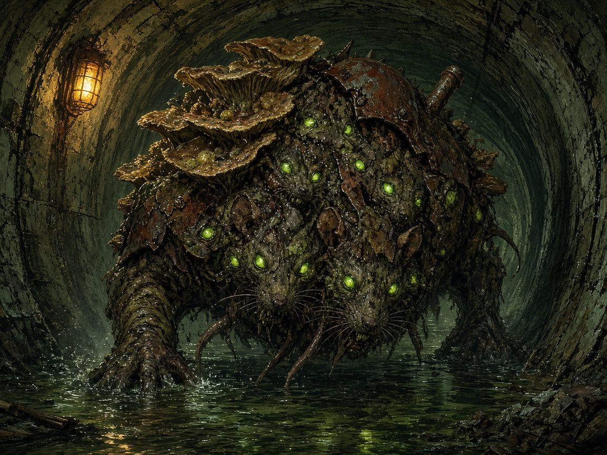

# Bestiary

Selected threats from *Mutagen*'s roster, rebuilt as 5e stat blocks. Challenge ratings were computed with the DMG's *Creating a Monster* method (effective hit points and AC for defense; damage per round over three rounds and attack bonus or save DC for offense) by `5e/tools/bestiary.py`, which re-checks them on every build. Creatures marked *Sample* leave a harvestable Surge (Options chapter).

| Creature | CR | Stage | Role |
|:--|:-:|:--|:--|
| Bloomhound | 1/2 | Base | Pack hunter |
| Scrapjack Picker | 1/2 | Base | Skirmisher |
| Spill Rats | 1/2 | Base | Swarm |
| Turret Drone | 1/2 | Base | Artillery |
| Ward Tough | 1/2 | Base | Soldier |
| Ostrander Cleaner | 1 | Base | Soldier |
| Sporecaller | 1 | Base | Healer, leader |
| Cleaner Hound | 2 | Evolution I | Pack hunter |
| Damper Drone | 2 | Evolution I | Controller |
| Drain Beast | 3 | Base | Brute |
| Boiler Hulk | 4 | Base | Brute |
| Bloom Knight | 5 | Evolution I | Soldier |
| The Brood Matriarch | 5 | Boss | Boss |
| Glasshide | 8 | Evolution I | Brute |
| Hunter-Killer Unit | 8 | Evolution I | Assassin |
| Warden Krell | 10 | Boss | Boss |
| The Drowned Choir | 11 | Evolution II | Controller |
| Feral Evolved | 12 | Evolution II | Elite |
| Reactor Wraith | 12 | Evolution II | Artillery, brute |
| Patient Zero | 23 | Boss | Boss (final) |

## Base Stage (levels 1–5)

#### Spill Rats
*Medium swarm of Tiny beasts, unaligned*

- **Armor Class** 12
- **Hit Points** 31 (7d8)
- **Speed** 30 ft., climb 30 ft.

| STR | DEX | CON | INT | WIS | CHA |
|:-:|:-:|:-:|:-:|:-:|:-:|
| 9 (-1) | 14 (+2) | 10 (+0) | 2 (-4) | 12 (+1) | 4 (-3) |

- **Skills** Perception +3
- **Damage Resistances** bludgeoning, piercing, slashing
- **Condition Immunities** charmed, frightened, grappled, paralyzed, petrified, prone, restrained, stunned
- **Senses** darkvision 30 ft., passive Perception 13
- **Languages** —
- **Challenge** 1/2 (100 XP) · **Proficiency Bonus** +2

***Swarm.*** The swarm can occupy another creature's space and vice versa, and it can move through any opening large enough for a Tiny rat. It can't regain hit points or gain temporary hit points.

***Mutagenic.*** A creature that starts its turn in the swarm's space must succeed on a DC 11 Constitution saving throw or gain 1 Flux (a Mutant) or become poisoned until the start of its next turn (anyone else).

##### Actions

***Bites.*** *Melee Weapon Attack:* +4 to hit, reach 0 ft., one target in the swarm's space. *Hit:* 7 (2d6) piercing damage plus 2 (1d4) poison damage, or 3 (1d6) piercing damage plus 2 (1d4) poison damage if the swarm has half of its hit points or fewer.

*Sample:* harvesting it (DC 13 Medicine or tinker's tools, 10 minutes) yields a **Strike + Toxin** Surge (see Gear).

*Hairless, glowing, wrong number of legs. They pour out of pipes in fours or more and all bite the same freelancer.*

#### Scrapjack Picker
*Medium humanoid (Mutant), chaotic neutral*

- **Armor Class** 14 (scrap armor)
- **Hit Points** 27 (5d8 + 5)
- **Speed** 40 ft.

| STR | DEX | CON | INT | WIS | CHA |
|:-:|:-:|:-:|:-:|:-:|:-:|
| 10 (+0) | 15 (+2) | 12 (+1) | 10 (+0) | 11 (+0) | 9 (-1) |

- **Skills** Perception +2, Sleight of Hand +4, Stealth +4
- **Senses** passive Perception 12
- **Languages** Common, Scrapjack cant
- **Challenge** 1/2 (100 XP) · **Proficiency Bonus** +2

***Pack Tactics.*** The picker has advantage on an attack roll against a creature if at least one of the picker's allies is within 5 feet of the creature and the ally isn't incapacitated.

***Magnet Gloves.*** The picker has advantage on checks to disarm a creature or steal an item, and on attacks against a creature wearing metal armor.

##### Actions

***Hook-Blade.*** *Melee Weapon Attack:* +4 to hit, reach 5 ft., one target. *Hit:* 6 (1d8 + 2) slashing damage.

***Rivet Gun.*** *Ranged Weapon Attack:* +4 to hit, range 30/120 ft., one target. *Hit:* 6 (1d8 + 2) piercing damage.

*Scavengers in welded scrap armour. They gang up on whoever has visible chrome and scatter when two are down.*

#### Ward Tough
*Medium humanoid (any), any alignment*

- **Armor Class** 12 (leather armor)
- **Hit Points** 39 (6d8 + 12)
- **Speed** 30 ft.

| STR | DEX | CON | INT | WIS | CHA |
|:-:|:-:|:-:|:-:|:-:|:-:|
| 15 (+2) | 12 (+1) | 14 (+2) | 9 (-1) | 10 (+0) | 10 (+0) |

- **Skills** Athletics +4, Intimidation +2
- **Senses** passive Perception 10
- **Languages** Common
- **Challenge** 1/2 (100 XP) · **Proficiency Bonus** +2

***Cowardly.*** While the tough has half of its hit points or fewer, it surrenders at the start of its turn on a d6 roll of 4–6 if it can see an enemy.

##### Actions

***Multiattack.*** The tough makes two attacks with its pipe or pistol.

***Pipe.*** *Melee Weapon Attack:* +4 to hit, reach 5 ft., one target. *Hit:* 5 (1d6 + 2) bludgeoning damage.

***Pistol.*** *Ranged Weapon Attack:* +3 to hit, range 30/120 ft., one target. *Hit:* 5 (1d8 + 1) piercing damage.

*Waders, a rebar club and a family to feed. He wants to be paid, not killed.*

#### Bloomhound
*Medium monstrosity, unaligned*

- **Armor Class** 13 (natural armor)
- **Hit Points** 32 (5d8 + 10)
- **Speed** 50 ft.

| STR | DEX | CON | INT | WIS | CHA |
|:-:|:-:|:-:|:-:|:-:|:-:|
| 15 (+2) | 14 (+2) | 14 (+2) | 3 (-4) | 12 (+1) | 6 (-2) |

- **Skills** Perception +3
- **Senses** darkvision 60 ft., passive Perception 13
- **Languages** —
- **Challenge** 1/2 (100 XP) · **Proficiency Bonus** +2

***Pack Tactics.*** The bloomhound has advantage on an attack roll against a creature if at least one of its allies is within 5 feet of the creature and the ally isn't incapacitated.

***Frenzy.*** The bloomhound deals an extra 2 damage with its attacks for each bloomhound that has died within 60 feet of it this combat (maximum +4).

##### Actions

***Split-Jaw.*** *Melee Weapon Attack:* +4 to hit, reach 5 ft., one target. *Hit:* 9 (2d6 + 2) piercing damage, and the target is grappled (escape DC 12). Until the grapple ends, the bloomhound can't bite another target.

*Sample:* harvesting it (DC 13 Medicine or tinker's tools, 10 minutes) yields a **Strike + Snare** Surge (see Gear).

*A dog that opens like a flower. One holds, the rest bite.*

#### Turret Drone
*Small construct, unaligned*

- **Armor Class** 15 (plating)
- **Hit Points** 27 (6d6 + 6)
- **Speed** 0 ft., fly 30 ft. (hover)

| STR | DEX | CON | INT | WIS | CHA |
|:-:|:-:|:-:|:-:|:-:|:-:|
| 6 (-2) | 16 (+3) | 12 (+1) | 3 (-4) | 12 (+1) | 1 (-5) |

- **Damage Immunities** poison
- **Condition Immunities** charmed, exhaustion, frightened, poisoned
- **Senses** darkvision 60 ft., passive Perception 11
- **Languages** —
- **Challenge** 1/2 (100 XP) · **Proficiency Bonus** +2

***Explosive.*** When the drone drops to 0 hit points, it explodes. Each creature within 10 feet of it must make a DC 12 Dexterity saving throw, taking 7 (2d6) fire damage on a failure or half as much on a success.

##### Actions

***Flechette Spray.*** The drone fires into a 10-foot-radius sphere centred on a point it can see within 90 feet. Each creature in it must make a DC 12 Dexterity saving throw, taking 9 (2d8) piercing damage on a failure or half as much on a success.

*A coffee-can drone with a shotgun. It hovers out of reach and fires into clusters.*

#### Ostrander Cleaner
*Medium humanoid (human), lawful neutral*

- **Armor Class** 16 (chain shirt, riot shield)
- **Hit Points** 45 (7d8 + 14)
- **Speed** 30 ft.

| STR | DEX | CON | INT | WIS | CHA |
|:-:|:-:|:-:|:-:|:-:|:-:|
| 14 (+2) | 13 (+1) | 14 (+2) | 10 (+0) | 12 (+1) | 10 (+0) |

- **Saving Throws** Con +4
- **Skills** Perception +3
- **Damage Resistances** poison
- **Senses** passive Perception 13
- **Languages** Common
- **Challenge** 1 (200 XP) · **Proficiency Bonus** +2

***Shield Wall.*** The cleaner gains +1 AC for each other cleaner within 5 feet of it (maximum +2).

***Hazmat Suit.*** The cleaner has advantage on saving throws against inhaled poisons, gases and the Mutagenic trait.

##### Actions

***Purge Rifle.*** *Ranged Weapon Attack:* +5 to hit, range 120/400 ft., one target. *Hit:* 8 (1d10 + 3) piercing damage. If the target is a Mutant, it loses one Primed Surge (its choice).

***Foam Sprayer (Recharge 5–6).*** The cleaner sprays a 15-foot cone. Each creature in it must make a DC 12 Dexterity saving throw. On a failure, it takes 10 (3d6) cold damage and is restrained until the end of its next turn; on a success, it takes half as much damage and isn't restrained.

*Hazmat suit, antimutagen rifle, no face. They advance in pairs behind riot shields and foam anyone mid-Surge.*

#### Sporecaller
*Medium humanoid (Mutant), chaotic neutral*

- **Armor Class** 12
- **Hit Points** 71 (11d8 + 22)
- **Speed** 30 ft.

| STR | DEX | CON | INT | WIS | CHA |
|:-:|:-:|:-:|:-:|:-:|:-:|
| 10 (+0) | 14 (+2) | 14 (+2) | 11 (+0) | 16 (+3) | 14 (+2) |

- **Saving Throws** Wis +5
- **Skills** Medicine +4, Religion +2
- **Damage Immunities** poison
- **Condition Immunities** poisoned
- **Senses** passive Perception 12
- **Languages** Common
- **Challenge** 1 (200 XP) · **Proficiency Bonus** +2

***Hymn of the Bloom.*** Allies of the sporecaller within 30 feet of it deal an extra 2 (1d4) damage with their weapon attacks while it isn't incapacitated.

##### Actions

***Spore Hymn.*** Each creature of the sporecaller's choice in a 20-foot-radius sphere centred on a point within 60 feet must make a DC 13 Constitution saving throw. On a failure, it takes 7 (2d6) poison damage and is poisoned until the end of its next turn; on a success, it takes half as much damage.

***Knit Wounds.*** One creature the sporecaller can see within 30 feet regains 11 (2d8 + 2) hit points.

*Sample:* harvesting it (DC 13 Medicine or tinker's tools, 10 minutes) yields a **Burst + Toxin** Surge (see Gear).

*A Bloom priest with a mouth full of flowers. It stays behind its flock, sings and knits their wounds shut.*

#### Drain Beast
*Huge monstrosity, unaligned*

- **Armor Class** 13 (natural armor)
- **Hit Points** 95 (10d12 + 30)
- **Speed** 30 ft., swim 40 ft.

| STR | DEX | CON | INT | WIS | CHA |
|:-:|:-:|:-:|:-:|:-:|:-:|
| 19 (+4) | 10 (+0) | 16 (+3) | 2 (-4) | 10 (+0) | 5 (-3) |

- **Skills** Stealth +2
- **Senses** darkvision 60 ft., passive Perception 10
- **Languages** —
- **Challenge** 3 (700 XP) · **Proficiency Bonus** +2

***Hold Breath.*** The beast can hold its breath for 30 minutes.

***Regeneration.*** The beast regains 5 hit points at the start of its turn unless it took acid or fire damage since its last turn.

##### Actions

***Bite.*** *Melee Weapon Attack:* +6 to hit, reach 10 ft., one target. *Hit:* 15 (2d10 + 4) piercing damage, and the target is grappled (escape DC 14). Until the grapple ends, the target is restrained and the beast can't bite another target.

***Tail Thrash (Recharge 5–6).*** Each creature within 20 feet of the beast, friend or foe, must make a DC 14 Dexterity saving throw, taking 17 (3d8 + 4) bludgeoning damage on a failure or half as much on a success.

*A drowned bull crocodile the size of a bus. It thrashes when surrounded and drags one victim under when not.*

#### Boiler Hulk
*Large construct, unaligned*

- **Armor Class** 15 (riveted plate)
- **Hit Points** 85 (9d10 + 36)
- **Speed** 30 ft.

| STR | DEX | CON | INT | WIS | CHA |
|:-:|:-:|:-:|:-:|:-:|:-:|
| 20 (+5) | 8 (-1) | 18 (+4) | 5 (-3) | 8 (-1) | 5 (-3) |

- **Damage Immunities** fire, poison
- **Condition Immunities** charmed, exhaustion, frightened, poisoned
- **Senses** passive Perception 9
- **Languages** understands Common but can't speak
- **Challenge** 4 (1,100 XP) · **Proficiency Bonus** +2

***Heated Body.*** A creature that touches the hulk or hits it with a melee attack while within 5 feet of it takes 3 (1d6) fire damage.

##### Actions

***Multiattack.*** The hulk makes two Furnace Fist attacks.

***Furnace Fist.*** *Melee Weapon Attack:* +7 to hit, reach 5 ft., one target. *Hit:* 14 (2d8 + 5) bludgeoning damage plus 3 (1d6) fire damage.

***Steam Vent (Recharge 5–6).*** Each creature within 20 feet of the hulk, friend or foe, must make a DC 14 Constitution saving throw, taking 21 (6d6) fire damage on a failure or half as much on a success. The hulk can't use Furnace Fist on its next turn.

*A walking furnace bolted onto a press-ganged diver. It wades into the middle of the party and vents.*

## Evolution I Stage (levels 5–12)

#### Cleaner Hound
*Medium construct, unaligned*

- **Armor Class** 15 (plating)
- **Hit Points** 52 (8d8 + 16)
- **Speed** 50 ft.

| STR | DEX | CON | INT | WIS | CHA |
|:-:|:-:|:-:|:-:|:-:|:-:|
| 16 (+3) | 15 (+2) | 14 (+2) | 3 (-4) | 13 (+1) | 1 (-5) |

- **Skills** Perception +3
- **Damage Immunities** poison
- **Condition Immunities** charmed, frightened, poisoned
- **Senses** darkvision 60 ft., passive Perception 13
- **Languages** —
- **Challenge** 2 (450 XP) · **Proficiency Bonus** +2

***Pack Tactics.*** The hound has advantage on an attack roll against a creature if at least one of its allies is within 5 feet of the creature and the ally isn't incapacitated.

***Mutagen Scent.*** The hound has advantage on Wisdom (Perception) checks to find Mutants and always knows which creature within 60 feet last Unleashed a Surge.

##### Actions

***Injector Bite.*** *Melee Weapon Attack:* +5 to hit, reach 5 ft., one target. *Hit:* 10 (2d6 + 3) piercing damage plus 7 (2d6) poison damage. If the target is a Mutant, it loses one Primed Surge (its choice).

*Ostrander's chrome dogs. They run in threes and chase whoever just Surged.*

#### Damper Drone
*Medium construct, unaligned*

- **Armor Class** 15 (plating)
- **Hit Points** 84 (13d8 + 26)
- **Speed** 0 ft., fly 30 ft. (hover)

| STR | DEX | CON | INT | WIS | CHA |
|:-:|:-:|:-:|:-:|:-:|:-:|
| 8 (-1) | 14 (+2) | 14 (+2) | 6 (-2) | 14 (+2) | 3 (-4) |

- **Damage Immunities** poison
- **Condition Immunities** charmed, frightened, poisoned
- **Senses** darkvision 60 ft., passive Perception 12
- **Languages** —
- **Challenge** 2 (450 XP) · **Proficiency Bonus** +2

***Damper Field.*** Each Unleash by a Mutant within 60 feet of the drone raises their Flux by 1 more. A spellcaster within 60 feet must succeed on a DC 14 Constitution save to cast a spell of 1st level or higher; on a failure the action is lost but the slot isn't.

##### Actions

***Null Pulse.*** The drone pulses a 10-foot-radius sphere centred on a point within 60 feet. Each creature in it must make a DC 14 Wisdom saving throw, taking 18 (4d8) force damage and being unable to take reactions until the start of its next turn on a failure, or half damage on a success.

*A floating antimutagen censer. It hangs back over the Ostrander line.*

#### Bloom Knight
*Medium plant, lawful neutral*

- **Armor Class** 17 (bark plate)
- **Hit Points** 102 (12d8 + 48)
- **Speed** 30 ft.

| STR | DEX | CON | INT | WIS | CHA |
|:-:|:-:|:-:|:-:|:-:|:-:|
| 18 (+4) | 10 (+0) | 18 (+4) | 9 (-1) | 14 (+2) | 12 (+1) |

- **Saving Throws** Str +7, Con +7
- **Damage Resistances** poison
- **Senses** tremorsense 30 ft., passive Perception 12
- **Languages** Common
- **Challenge** 5 (1,800 XP) · **Proficiency Bonus** +3

***Regrowth.*** The knight regains 5 hit points at the start of its turn unless it took fire damage since its last turn.

***Rooted Stance.*** The knight can't be moved or knocked prone against its will while it is on soil or plants.

##### Actions

***Multiattack.*** The knight makes two Thorn Glaive attacks.

***Thorn Glaive.*** *Melee Weapon Attack:* +7 to hit, reach 10 ft., one target. *Hit:* 10 (1d12 + 4) slashing damage plus 4 (1d8) poison damage, and the target must succeed on a DC 15 Constitution saving throw or be poisoned until the end of its next turn.

*Sample:* harvesting it (DC 13 Medicine or tinker's tools, 10 minutes) yields a **Strike + Toxin** Surge (see Gear).

*A holy warrior grown from a single rosebush. It stands in front of Sporecallers and never retreats.*

#### Glasshide
*Huge monstrosity, unaligned*

- **Armor Class** 17 (natural armor)
- **Hit Points** 147 (14d12 + 56)
- **Speed** 30 ft.

| STR | DEX | CON | INT | WIS | CHA |
|:-:|:-:|:-:|:-:|:-:|:-:|
| 21 (+5) | 9 (-1) | 19 (+4) | 3 (-4) | 11 (+0) | 6 (-2) |

- **Saving Throws** Con +7
- **Damage Vulnerabilities** lightning, thunder
- **Damage Resistances** bludgeoning, piercing and slashing from nonmagical attacks
- **Senses** darkvision 60 ft., passive Perception 10
- **Languages** —
- **Challenge** 8 (3,900 XP) · **Proficiency Bonus** +3

***Territorial.*** If another glasshide is within 120 feet, at the start of its turn roll a d6: on a 1–4, it attacks that glasshide instead of anything else.

***Crystal Body.*** A creature that hits the glasshide with a melee attack while within 5 feet takes 3 (1d6) slashing damage.

##### Actions

***Multiattack.*** The glasshide makes two Crystal Maul attacks.

***Crystal Maul.*** *Melee Weapon Attack:* +8 to hit, reach 10 ft., one target. *Hit:* 16 (2d10 + 5) bludgeoning damage. A Large or smaller target must succeed on a DC 16 Strength saving throw or be knocked prone.

***Shatter Roar (Recharge 5–6).*** Each creature within 20 feet of the glasshide, friend or foe, must make a DC 15 Constitution saving throw, taking 36 (8d8) thunder damage on a failure or half as much on a success.

*Sample:* harvesting it (DC 13 Medicine or tinker's tools, 10 minutes) yields a **Pulse + Quake** Surge (see Gear).

*A bear grown into a cathedral of quartz. It charges the loudest thing in the room.*

#### Hunter-Killer Unit
*Medium construct, lawful evil*

- **Armor Class** 18 (plating)
- **Hit Points** 165 (22d8 + 66)
- **Speed** 40 ft.

| STR | DEX | CON | INT | WIS | CHA |
|:-:|:-:|:-:|:-:|:-:|:-:|
| 16 (+3) | 20 (+5) | 16 (+3) | 14 (+2) | 14 (+2) | 6 (-2) |

- **Saving Throws** Dex +8, Con +6
- **Skills** Perception +5, Stealth +8
- **Damage Resistances** lightning
- **Damage Immunities** poison
- **Condition Immunities** charmed, frightened, poisoned
- **Senses** darkvision 120 ft., passive Perception 15
- **Languages** Common
- **Challenge** 8 (3,900 XP) · **Proficiency Bonus** +3

***Hunter Protocol.*** The unit has advantage on attack rolls against a creature that has half its hit points or fewer.

***Evasion.*** If the unit is subjected to an effect that allows it to make a Dexterity saving throw to take only half damage, it instead takes no damage if it succeeds and half if it fails.

##### Actions

***Multiattack.*** The unit makes three attacks with its mono-wire or arc pistol, in any combination.

***Mono-Wire.*** *Melee Weapon Attack:* +8 to hit, reach 10 ft., one target. *Hit:* 16 (2d10 + 5) slashing damage.

***Arc Pistol.*** *Ranged Weapon Attack:* +8 to hit, range 60/120 ft., one target. *Hit:* 16 (2d10 + 5) lightning damage, and the target can't take reactions until the start of its next turn.

##### Reactions

***Countermeasure.*** When a creature within 60 feet Unleashes a Surge or casts a spell, the unit makes one Arc Pistol attack against it.

*Ostrander's chrome assassin. It kills the medic first.*

## Evolution II Stage (levels 11–20)

#### Feral Evolved
*Large aberration (Mutant), chaotic neutral*

- **Armor Class** 17 (natural armor)
- **Hit Points** 207 (18d10 + 108)
- **Speed** 40 ft., climb 40 ft.

| STR | DEX | CON | INT | WIS | CHA |
|:-:|:-:|:-:|:-:|:-:|:-:|
| 22 (+6) | 16 (+3) | 22 (+6) | 8 (-1) | 14 (+2) | 10 (+0) |

- **Saving Throws** Str +10, Con +10
- **Skills** Athletics +10, Perception +6
- **Damage Resistances** acid, fire, poison
- **Senses** darkvision 120 ft., passive Perception 16
- **Languages** understands Common
- **Challenge** 12 (8,400 XP) · **Proficiency Bonus** +4

***Regeneration.*** The evolved regains 10 hit points at the start of its turn if it has at least 1 hit point.

***Shift (1/Day).*** The first time the evolved drops to half its hit points or fewer, it stops at exactly half, ends every condition on itself, and each creature within 30 feet must succeed on a DC 17 Wisdom saving throw or be frightened of it for 1 minute (save ends at end of each turn). Its claws deal an extra 9 (2d8) damage for the rest of the fight.

##### Actions

***Multiattack.*** The evolved makes three Wrong Claws attacks.

***Wrong Claws.*** *Melee Weapon Attack:* +10 to hit, reach 10 ft., one target. *Hit:* 19 (2d12 + 6) slashing damage.

*Sample:* harvesting it (DC 13 Medicine or tinker's tools, 10 minutes) yields a **Strike + Kinetic** Surge (see Gear).

*A freelancer whose second Evolution went wrong. It remembers your names.*

#### The Drowned Choir
*Huge swarm of Medium undead, neutral evil*

- **Armor Class** 16
- **Hit Points** 230 (20d12 + 100)
- **Speed** 20 ft., swim 40 ft.

| STR | DEX | CON | INT | WIS | CHA |
|:-:|:-:|:-:|:-:|:-:|:-:|
| 16 (+3) | 12 (+1) | 20 (+5) | 10 (+0) | 16 (+3) | 20 (+5) |

- **Saving Throws** Wis +7, Cha +9
- **Damage Resistances** bludgeoning, piercing, slashing
- **Damage Immunities** poison, psychic
- **Condition Immunities** charmed, frightened, grappled, paralyzed, poisoned, prone, restrained
- **Senses** blindsight 60 ft., passive Perception 13
- **Languages** Common (all at once)
- **Challenge** 11 (7,200 XP) · **Proficiency Bonus** +4

***Swarm.*** The Choir can occupy another creature's space and vice versa. It can't regain hit points.

***Conductor.*** Allies within 60 feet of the Choir deal an extra 4 (1d8) psychic damage with their attacks.

##### Actions

***Undertow Song.*** Each creature of the Choir's choice within 30 feet that can hear it must make a DC 17 Wisdom saving throw. On a failure, it takes 33 (6d10) psychic damage and must use its next move to walk toward the nearest deep water or the Choir; on a success, it takes half as much damage.

***Drowning Grasp.*** *Melee Weapon Attack:* +9 to hit, reach 0 ft., one creature in the Choir's space. *Hit:* 22 (4d8 + 4) cold damage, and the target is grappled (escape DC 17) and can't breathe.

*Fifty drowned voices fused into one. It sings the living toward the water.*

#### Reactor Wraith
*Large undead, neutral evil*

- **Armor Class** 17
- **Hit Points** 210 (20d10 + 100)
- **Speed** 0 ft., fly 40 ft. (hover)

| STR | DEX | CON | INT | WIS | CHA |
|:-:|:-:|:-:|:-:|:-:|:-:|
| 10 (+0) | 18 (+4) | 20 (+5) | 12 (+1) | 14 (+2) | 16 (+3) |

- **Saving Throws** Con +9, Wis +6
- **Damage Resistances** acid, cold, lightning; bludgeoning, piercing and slashing from nonmagical attacks
- **Damage Immunities** fire, necrotic, poison, radiant
- **Condition Immunities** charmed, exhaustion, grappled, paralyzed, poisoned, prone, restrained
- **Senses** darkvision 120 ft., passive Perception 12
- **Languages** —
- **Challenge** 12 (8,400 XP) · **Proficiency Bonus** +4

***Incorporeal Movement.*** The wraith can move through creatures and objects as if they were difficult terrain. It takes 5 (1d10) force damage if it ends its turn inside an object.

***Radiation.*** A creature that starts its turn within 10 feet of the wraith takes 7 (2d6) radiant damage.

##### Actions

***Multiattack.*** The wraith uses Irradiate twice.

***Irradiate.*** *Ranged Spell Attack:* +10 to hit, range 30 ft., one target. *Hit:* 27 (5d10) radiant damage, and the target's hit point maximum is reduced by 5 until it finishes a long rest.

***Meltdown (Recharge 5–6).*** Each creature within 30 feet of the wraith, friend or foe, must make a DC 18 Constitution saving throw, taking 63 (18d6) fire damage on a failure or half as much on a success. The wraith can't use Meltdown again until it has used Irradiate on a turn.

*The ghost of a cooling tower. It hovers into the middle of the fight and goes critical.*

## Bosses

#### The Brood Matriarch
*Huge monstrosity, unaligned*

- **Armor Class** 14 (natural armor)
- **Hit Points** 136 (13d12 + 52)
- **Speed** 0 ft. (rooted); 30 ft. after Shift

| STR | DEX | CON | INT | WIS | CHA |
|:-:|:-:|:-:|:-:|:-:|:-:|
| 18 (+4) | 8 (-1) | 18 (+4) | 4 (-3) | 12 (+1) | 10 (+0) |

- **Saving Throws** Con +7, Wis +4
- **Damage Immunities** poison
- **Condition Immunities** poisoned, prone
- **Senses** tremorsense 60 ft., passive Perception 11
- **Languages** —
- **Challenge** 5 (1,800 XP) · **Proficiency Bonus** +3

***Legendary Resistance (1/Day).*** If the Matriarch fails a saving throw, she can choose to succeed instead.

***Shift.*** When the Matriarch first drops to half her hit points or fewer, she tears free of the pipes: she ends every condition on herself, her speed becomes 30 feet, and she can make one Brood-Lash attack against each of two targets with one action.

##### Actions

***Multiattack.*** The Matriarch makes two Brood-Lash attacks.

***Brood-Lash.*** *Melee Weapon Attack:* +6 to hit, reach 15 ft., one target. *Hit:* 13 (2d8 + 4) bludgeoning damage, and the target is grappled (escape DC 14).

***Screech (Recharge 5–6).*** Each creature within 30 feet must make a DC 14 Wisdom saving throw, taking 14 (4d6) psychic damage and becoming frightened until the end of its next turn on a failure, or half damage on a success.

##### Legendary Actions

The Matriarch can take 2 legendary actions, choosing from the options below. Only one option can be used at a time and only at the end of another creature's turn. She regains spent legendary actions at the start of her turn.

***Lash.*** The Matriarch makes one Brood-Lash attack.

***Birth (Costs 2 Actions).*** Two **Spill Rats** swarms burst from her body into unoccupied spaces within 15 feet (no more than four at once). They act on her initiative.

*Sample:* harvesting it (DC 13 Medicine or tinker's tools, 10 minutes) yields a **Wave + Snare** Surge (see Gear).

*A womb the size of a truck, rooted into the pipes. She holds the strongest freelancer and Births when the swarms thin out.*

#### Warden Krell
*Medium humanoid (human), lawful evil*

- **Armor Class** 19 (riot plate, shield)
- **Hit Points** 187 (22d8 + 88)
- **Speed** 30 ft.

| STR | DEX | CON | INT | WIS | CHA |
|:-:|:-:|:-:|:-:|:-:|:-:|
| 18 (+4) | 14 (+2) | 18 (+4) | 14 (+2) | 16 (+3) | 18 (+4) |

- **Saving Throws** Str +8, Con +8, Wis +7
- **Skills** Athletics +8, Intimidation +8, Perception +7
- **Damage Resistances** poison
- **Senses** passive Perception 17
- **Languages** Common
- **Challenge** 10 (5,900 XP) · **Proficiency Bonus** +4

***Legendary Resistance (2/Day).*** If Krell fails a saving throw, he can choose to succeed instead.

***Leader.*** Allies within 60 feet of Krell that can hear him deal an extra 3 (1d6) damage with their weapon attacks.

***Shift.*** When Krell first drops to half his hit points or fewer, he ends every condition on himself, gains +1 AC, and his Riot Slam recharges and becomes a 20-foot burst around him.

##### Actions

***Multiattack.*** Krell makes three Purge Carbine or Shock Baton attacks.

***Shock Baton.*** *Melee Weapon Attack:* +8 to hit, reach 5 ft., one target. *Hit:* 11 (2d6 + 4) bludgeoning damage plus 4 (1d8) lightning damage.

***Purge Carbine.*** *Ranged Weapon Attack:* +8 to hit, range 120/400 ft., one target. *Hit:* 13 (2d8 + 4) piercing damage. A Mutant hit loses one Primed Surge and gains 1 Flux.

***Riot Slam (Recharge 5–6).*** Krell slams his shield forward in a 15-foot cone. Each creature in it must make a DC 16 Strength saving throw, taking 27 (6d8) thunder damage and falling prone on a failure, or half damage on a success.

##### Legendary Actions

Krell can take 3 legendary actions, choosing from the options below. Only one option can be used at a time and only at the end of another creature's turn. He regains spent legendary actions at the start of his turn.

***Fire.*** Krell makes one Purge Carbine attack.

***Advance.*** Krell moves up to half his speed without provoking opportunity attacks.

***Call the Line (Costs 2 Actions).*** Two **Ostrander Cleaners** arrive from the nearest door or cover (no more than four at once). They act on his initiative.

*The Ostrander officer who ran the Lockdown camps. He opens from cover, Purges whoever has the most Primed Surges and calls the Line the moment the party bunches up.*

#### Patient Zero
*Huge aberration (Mutant), neutral*

- **Armor Class** 19 (natural armor)
- **Hit Points** 348 (24d12 + 192)
- **Speed** 40 ft.; fly 40 ft. after Shift

| STR | DEX | CON | INT | WIS | CHA |
|:-:|:-:|:-:|:-:|:-:|:-:|
| 24 (+7) | 14 (+2) | 26 (+8) | 20 (+5) | 22 (+6) | 24 (+7) |

- **Saving Throws** Con +15, Wis +13, Cha +14
- **Skills** Insight +13, Perception +13
- **Damage Resistances** acid, cold, fire, lightning, necrotic; bludgeoning, piercing and slashing from nonmagical attacks
- **Damage Immunities** poison, psychic
- **Condition Immunities** charmed, frightened, poisoned
- **Senses** truesight 120 ft., passive Perception 23
- **Languages** all, telepathy 1 mile
- **Challenge** 23 (50,000 XP) · **Proficiency Bonus** +7

***Legendary Resistance (3/Day).*** If Patient Zero fails a saving throw, it can choose to succeed instead.

***Regeneration.*** Patient Zero regains 20 hit points at the start of its turn unless it took radiant damage since its last turn.

***Source.*** Mutants within 60 feet of Patient Zero can't lower their Flux by any means, and their Overloads always roll twice and use the worse result.

***Shift.*** When Patient Zero first drops to half its hit points or fewer, it ends every condition on itself, gains a flying speed of 40 feet, and its Unmaking Touch can target three creatures with one attack roll each instead of one.

##### Actions

***Multiattack.*** Patient Zero makes three Unmaking Touch attacks.

***Unmaking Touch.*** *Melee Weapon Attack:* +14 to hit, reach 15 ft., one target. *Hit:* 29 (4d10 + 7) necrotic damage. A Mutant hit gains 2 Flux; any other creature must succeed on a DC 21 Constitution saving throw or its hit point maximum is reduced by the damage taken until it finishes a long rest.

***The First Song (Recharge 5–6).*** Each creature within 60 feet that can hear Patient Zero must make a DC 22 Wisdom saving throw, taking 55 (10d10) psychic damage and becoming frightened for 1 minute on a failure (repeat the save at the end of each of its turns), or half damage on a success.

##### Legendary Actions

Patient Zero can take 3 legendary actions, choosing from the options below. Only one option can be used at a time and only at the end of another creature's turn. It regains spent legendary actions at the start of its turn.

***Touch.*** Patient Zero makes one Unmaking Touch attack.

***Speak.*** One creature that can hear it must succeed on a DC 22 Wisdom saving throw or use its reaction to move up to its speed toward Patient Zero.

***Bloom (Costs 2 Actions).*** Two **Bloom Knights** grow from the floor within 30 feet (no more than four at once). They act on its initiative.

*The first person ever to take the Mutagen, still alive in the reactor core. It talks before it fights. Save its Shift for after the party has spent their Final Forms.*

