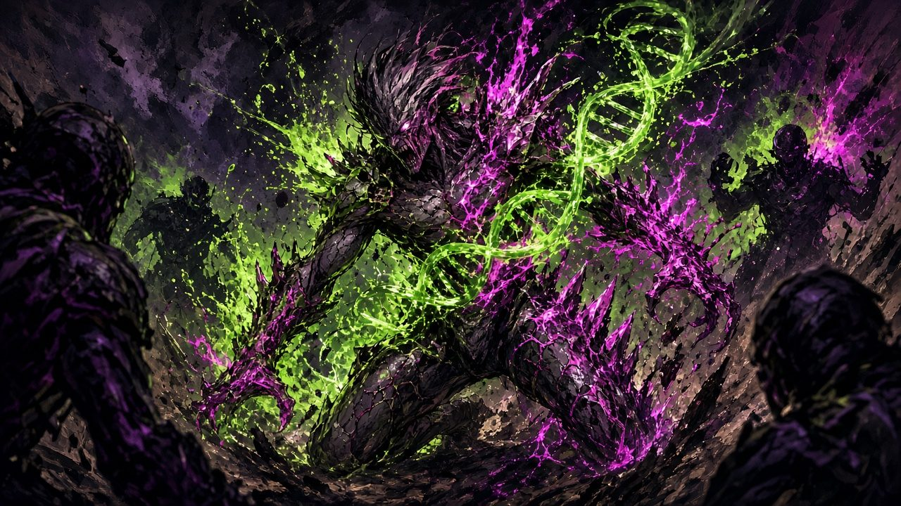
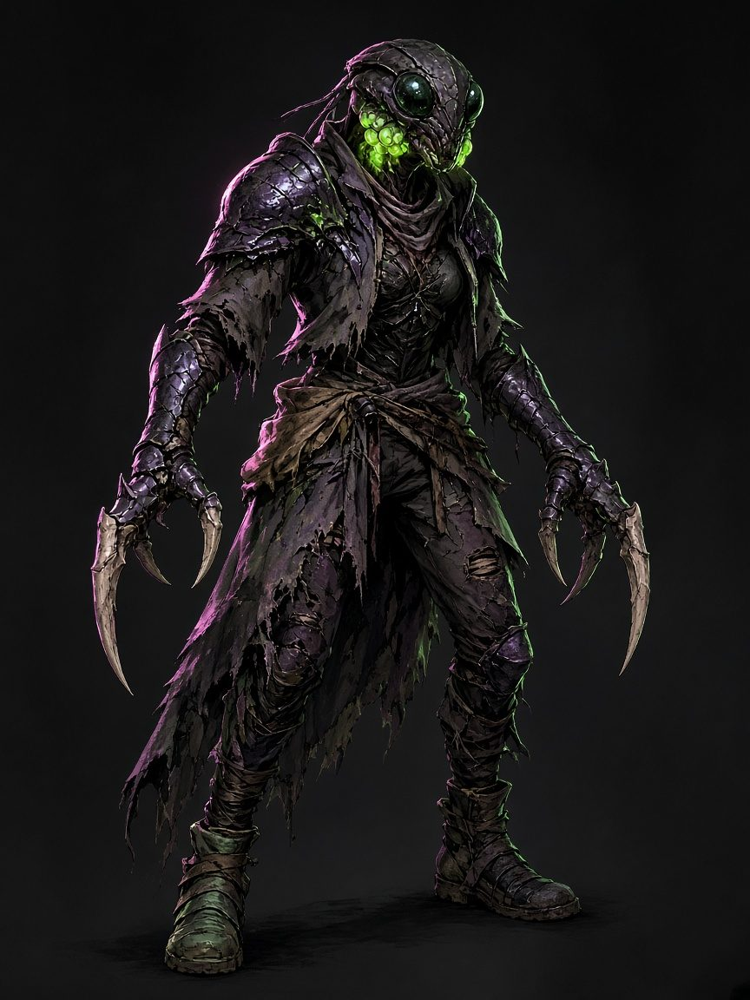

# The Mutant

*The flood came up through the reactor district and left something in the water. Most people who drank it got sick. A few got* different*. Their bones learned new shapes; their blood learned to burn, to heal, to sing. GRAFT pays them to go back into the Spill. They call themselves freelancers. Everyone else calls them Mutants.*

A Mutant's power is the **Mutagen**, a living compound that rewrites the body under stress. A Mutant doesn't cast spells. When danger comes, their body *prepares*: certain Surges come ready (they're **Primed**) and others take more effort. Every Surge raises the Mutant's **Flux**, the chemical pressure in their blood. Push Flux past its limit and the body **Overloads**: it Blooms (Bio) or Glitches (Chrome) in ways that are sometimes wonderful and sometimes horrible.

> ##### Designing a Mutant
> - **Pick a Form** (the subclass) at 1st level: the shape your body is growing toward. **Juggernaut** (the wall), **Skitter** (the blur), **Oracle** (the eye), **Alembic** (the medic and alchemist), **Siren** (the voice).
> - **Pick a Material:** **Bio** (flesh: heals better, Blooms), **Chrome** (implants: adaptable, Glitches) or **Splice** (both, at a cost).
> - **Build two Surges** from a Shape and an Effect. A Mutant with a greatsword and a *Strike + Kinetic* Surge is a fine first character.

## Creating a Mutant

**Quick Build.** Put your highest score in Constitution, then Strength or Dexterity (Wisdom for an Oracle, Intelligence for an Alembic, Charisma for a Siren). Choose the *GRAFT Freelancer* background (Options chapter).

**Multiclassing.** To multiclass into or out of the Mutant you need **Constitution 13**. Multiclassing into the Mutant gives you proficiency with light armor, simple weapons and one skill from the Mutant's list. The Mutant has no spell slots and adds nothing to your spellcaster level.

### Class Features
As a Mutant, you gain the following class features.

**Hit Points**
- **Hit Dice:** 1d10 per Mutant level
- **Hit Points at 1st Level:** 10 + your Constitution modifier
- **Hit Points at Higher Levels:** 1d10 (or 6) + your Constitution modifier per Mutant level after 1st

**Proficiencies**
- **Armor:** Light armor, medium armor, shields
- **Weapons:** Simple weapons, martial weapons
- **Tools:** One type of artisan's tools or the herbalism kit
- **Saving Throws:** Constitution, Strength
- **Skills:** Choose two from Acrobatics, Athletics, Insight, Intimidation, Medicine, Nature, Perception, Stealth and Survival

**Equipment**

You start with the following equipment, in addition to the equipment granted by your background:
- (*a*) scale mail or (*b*) leather armor, a shortbow and 20 arrows
- (*a*) a martial weapon and a shield or (*b*) two martial weapons
- (*a*) a dungeoneer's pack or (*b*) an explorer's pack
- a GRAFT stim (heals 1d4 + 1 when drunk as an action; see Options)

##### The Mutant

| Level | Proficiency Bonus | Features | Surge Dice | Surges Known | Flux Limit | Sequence Die | Prime | Mutations Known |
|:-:|:-:|:--|:-:|:-:|:-:|:-:|:-:|:-:|
| 1st | +2 | Mutant Body, Surges, Flux, Regeneration, Material, Form | 1d6 | 2 | 1 | d4 | 1 | — |
| 2nd | +2 | Mutations, Churn | 1d6 | 2 | 1 | d4 | 1 | 2 |
| 3rd | +2 | Form feature, Deeper Sequence | 1d6 | 3 | 2 | d6 | 2 | 2 |
| 4th | +2 | Ability Score Improvement | 1d6 | 3 | 2 | d6 | 2 | 2 |
| 5th | +3 | Extra Attack, Surge Dice | 2d6 | 4 | 3 | d6 | 2 | 3 |
| 6th | +3 | Evolution I (Form feature) | 2d6 | 4 | 3 | d8 | 3 | 3 |
| 7th | +3 | Last Gasp | 2d6 | 5 | 4 | d8 | 3 | 4 |
| 8th | +3 | Ability Score Improvement | 2d6 | 5 | 4 | d8 | 3 | 4 |
| 9th | +4 | Improved Regeneration | 2d6 | 6 | 5 | d8 | 3 | 5 |
| 10th | +4 | Form feature | 2d6 | 6 | 5 | d8 | 3 | 5 |
| 11th | +4 | Saturated Strikes, Surge Dice | 3d6 | 7 | 6 | d8 | 3 | 5 |
| 12th | +4 | Ability Score Improvement | 3d6 | 7 | 6 | d8 | 3 | 6 |
| 13th | +5 | Adaptive Biology | 3d6 | 8 | 7 | d8 | 3 | 6 |
| 14th | +5 | Evolution II (Form feature) | 3d6 | 8 | 7 | d12 | 4 | 6 |
| 15th | +5 | Controlled Overload, Apex Mutations | 3d6 | 9 | 8 | d12 | 4 | 7 |
| 16th | +5 | Ability Score Improvement | 3d6 | 9 | 8 | d12 | 4 | 7 |
| 17th | +6 | Surge Dice | 4d6 | 10 | 9 | d12 | 4 | 8 |
| 18th | +6 | Perfect Organism | 4d6 | 10 | 9 | d12 | 4 | 8 |
| 19th | +6 | Ability Score Improvement | 4d6 | 11 | 10 | d12 | 4 | 9 |
| 20th | +6 | Final Form | 4d6 | 11 | 10 | d12 | 4 | 9 |

### Mutant Body
*1st-level Mutant feature*

Your body grows its own weapons: claws, spurs, bone blades, hydraulic pistons. Your unarmed strikes count as **natural weapons** that deal **1d8** slashing, piercing or bludgeoning damage (your choice each hit) on a hit. A natural weapon is a simple melee weapon with the finesse property; it can't be disarmed and doesn't need a free hand. Its damage die becomes **1d10 at 11th level**.

You can use a natural weapon, a martial weapon or any other weapon with your Surges.

### Surges
*1st-level Mutant feature*

A **Surge** is a burst of mutation you build from parts, the way a chef builds a dish.

- A **Shape** says *how* the Surge reaches its target: a hit with a weapon, a bolt, a cone, a burst, a pulse around you, or a touch that changes an ally.
- An **Effect** says *what* it does: its damage type and its rider (push, burn, poison, blind and so on), or, for the Infuse Shape, the boon it gives.
- **Twists** (optional, chosen when you Unleash) modify it.

**Surges Known.** You know two Surges, each one Shape plus one Effect from the parts available to you (see *Surge Parts*). You learn more as shown in the Surges Known column. Name them; they're yours. When you gain a level in this class, you can rebuild one Surge you know.

**Parts available.** At 1st level you have the **base** parts (Strike, Bolt, Wave and Infuse Shapes; Kinetic and Snare Effects) plus the parts unlocked by the Root of your Form's primary tree. Each other tree's Root you take as a Mutation unlocks its parts too.

**Surge Dice.** Surge damage is measured in **Surge dice**, which are d6s, shown in the Surge Dice column: 1d6, 2d6 at 5th, 3d6 at 11th, 4d6 at 17th.

**Surge Ability.** Your Surge ability is **Constitution**, unless your Form says otherwise (Oracle: Wisdom; Alembic: Intelligence; Siren: Charisma).

- **Surge save DC** = 8 + your proficiency bonus + your Surge ability modifier
- **Surge attack modifier** = your proficiency bonus + your Surge ability modifier

**Unleashing.** You can **Unleash** at most **one Surge per turn**. Unleashing it raises your Flux by **1, plus 1 for each Twist** you add (see *Flux*). The Shape says what action, if any, it takes.

### The Sequence
*1st-level Mutant feature*

Write your Surges in a numbered list, your **Sequence**, with one numbered slot for each face of your **Sequence die** (d4 at 1st level; it grows as shown in the table). Put each Surge you know in a slot; slots left over are empty. Rearrange the list whenever you finish a long rest.

**Priming.** When you roll initiative, roll your Sequence die a number of times equal to your **Prime** number (1 at 1st level; see the table). Each Surge whose slot comes up is **Primed** for this combat:
- The **first** time you Unleash a Primed Surge in this combat, it costs **1 less Flux** (its basic cost of 1 becomes 0).
- If the same slot comes up twice, that Surge is **Amped**: its first Unleash costs **no Flux at all, even for its Twists**, and it rolls **one extra Surge die**.
- If the roll lands on an **empty** slot, your body improvises: roll on the **Wild Surge** table (after *Surge Parts*) and Unleash that result as a free action at the start of your first turn. It costs no Flux and counts as your Surge for that turn.

You can always Unleash a Surge that isn't Primed; it just costs its full Flux. The dice give you a bargain, never a lock-out.

### Flux
*1st-level Mutant feature*

**Flux** measures how hard you're pushing your body. It starts at 0 and rises as you Unleash Surges. Your **Flux Limit** is shown in the table. When you finish a **short or long rest**, your Flux returns to 0.

**Overload.** You can Unleash a Surge that would take your Flux past your Limit. When you do, the Surge happens, and then you **Overload**:
1. You take necrotic damage equal to a number of d6s equal to your proficiency bonus. This damage can't reduce you below 1 hit point.
2. Roll a d12 on the **Bloom** table (Bio) or the **Glitch** table (Chrome).
3. Your Flux returns to 0.

You can't Overload more than once per turn. A creature who Overloads while at 1 hit point or fewer suffers no further damage from it.

> ##### Reading Flux at the Table
> A 1st-level Mutant has a Flux Limit of 1 and Primes once per fight, so between rests (two fights) they can Unleash about **three Surges** before Overloading: two Primed ones for free and one paid. By 11th level (Flux Limit 6, Prime 3) they can Surge almost every turn and add Twists. Track Flux with a d20 or tally marks next to your Sequence. Overloading once in a hard fight is normal; that's the point.

### Regeneration
*1st-level Mutant feature*

Your cells knit faster than anyone's should, and you can share that. As a **bonus action**, touch yourself or a willing creature and choose one:
- The creature regains hit points equal to **1d8 + your Surge ability modifier** (minimum 1).
- You end the **poisoned** condition or one **disease** affecting the creature.

You can use this feature a number of times equal to your **proficiency bonus**, and regain all expended uses when you finish a long rest. It has no effect on undead or constructs.

The healing grows as you level: **2d8** at 5th level, **3d8** at 9th, **4d8** at 13th and **5d8** at 17th.

> ##### Regeneration vs. Healing Spells
> *Cure Wounds* heals 1d8 + modifier as an action; *Healing Word* heals 1d4 + modifier as a bonus action at range. Regeneration heals like *Cure Wounds* with *Healing Word*'s action cost, but only by touch, and its uses (2 at 1st level) match a 1st-level Cleric's, Bard's or Druid's two spell slots. Its dice rise in step with a support caster upcasting *Cure Wounds* into their best slot. Over a day it heals more than a Paladin's *Lay on Hands* (15 vs 5 at 1st level, 65 vs 25 at 5th) and less than a Bard who spends every slot on *Healing Word* or a Druid on *Cure Wounds* (see *Design Notes*).

### Material
*1st-level Mutant feature*

Your body takes the Mutagen in one of three ways. Choose one.

**Bio.** You're flesh all the way down.
- **Knit.** When you regain hit points from Regeneration or by spending Hit Dice, you regain extra hit points equal to your proficiency bonus.
- When you Overload, you roll on the **Bloom** table.

**Chrome.** Your mutations grow around implants and hardware.
- **Firmware.** When you finish a short rest, you can rebuild one Surge you know or swap one Mutation you know for another you qualify for.
- **Sealed Systems.** You have advantage on saving throws against poison and disease.
- When you Overload, you roll on the **Glitch** table.
- **Upkeep.** Chrome needs care: if you go a week without 1 gp of parts and an hour of maintenance, you lose Firmware until you do.

**Splice.** You're both.
- You gain **Knit** and **Firmware**.
- Your Flux Limit is **1 lower** than the table shows (minimum 1).
- When you Overload, choose the Bloom or Glitch table before you roll.

### Form
*1st-level Mutant feature*

Choose the **Form** your body is growing toward: Juggernaut, Skitter, Oracle, Alembic or Siren, each detailed at the end of the class description. Your choice grants you features at 1st level and again at 3rd, 6th (Evolution I), 10th and 14th (Evolution II) level.

Each Form has a **primary Mutation tree**. You gain that tree's **Root** for free at 1st level (it doesn't count against your Mutations Known), and only your primary tree's Apex Mutation is open to you at 15th level.

### Mutations
*2nd-level Mutant feature*

Your body has started growing extra features. You learn **two Mutations** of your choice from the *Mutation Trees* section. You learn more as shown in the Mutations Known column.

Each tree has a **Root**, **Tier I** Mutations, **Tier II** Mutations and an **Apex**.
- **Root:** learn this before any other Mutation of its tree. Your primary tree's Root is free. Each Root also unlocks the Surge parts listed with it.
- **Tier I:** needs the tree's Root.
- **Tier II:** needs 6th level, the Root, and two other Mutations of that tree.
- **Apex:** needs 15th level, your **primary** tree, the Root and four other Mutations of that tree.
- **Body** Mutations (the open list) have no Root; some need a level.

When you gain a level in this class, you can replace one Mutation you know with another you qualify for.

**Push.** Some Mutations have a **Push** option. You can use it by raising your Flux by 1 (this can make you Overload). You can Push each Mutation only once per turn.

### Churn
*2nd-level Mutant feature*

As a **bonus action** on your turn in combat, you can force your body to reshuffle: raise your Flux by 1 and roll your Sequence die once. The Surge in that slot is Primed (or Amped, if it already was Primed and its discount is unused). An empty slot gives you a Wild Surge as normal, which you can Unleash immediately as part of this bonus action.

### Deeper Sequence
*3rd-level Mutant feature*

Your body's repertoire widens. Your Sequence die becomes a **d6** (two more slots), your **Prime** rises to 2, and you gain proficiency in one skill from the Mutant's list. Additionally, you regain one expended use of Regeneration when you finish a short rest.

### Ability Score Improvement
*4th-level Mutant feature*

When you reach 4th level, and again at 8th, 12th, 16th and 19th level, you can increase one ability score of your choice by 2, or you can increase two ability scores of your choice by 1. As normal, you can't increase an ability score above 20 using this feature. If your game uses feats, you can take a feat instead.

### Extra Attack
*5th-level Mutant feature*

You can attack twice, instead of once, whenever you take the Attack action on your turn. A **Bolt** Surge can replace one of these attacks.

### Evolution I
*6th-level Mutant feature*

The Mutagen finishes its first rewrite of you. Your appearance changes (see your Form's *Looks* table), and:
- Your **Prime** rises to 3 and your **Sequence die** becomes a **d8**.
- **Signature Surge.** Choose one Surge you know as your Signature. It carries one Twist of your choice for free, every time (choose the Twist when you choose the Signature). Being Primed doesn't change that.
- **Emergence.** As a bonus action, you can show what you've become. You gain temporary hit points equal to your Mutant level + your Surge ability modifier, each creature of your choice within 30 feet that can see you must succeed on a Wisdom saving throw against your Surge save DC or be frightened of you until the end of your next turn, and your Signature Surge becomes Amped if it wasn't already. Once you use Emergence, you can't do so again until you finish a long rest.
- You gain your Form's **Evolution I** feature.

### Last Gasp
*7th-level Mutant feature*

When you are reduced to 0 hit points but not killed outright, you can drop to 1 hit point instead and **Overload** (roll on your Bloom or Glitch table and set your Flux to 0, but take no Overload damage). Once you use this feature, you can't use it again until you finish a long rest.

### Improved Regeneration
*9th-level Mutant feature*

Your Regeneration can now reach a creature you can see within **30 feet** (a spray of tissue, a stim dart, a nanite cloud), and you can use it one additional time per long rest (proficiency bonus + 1).

### Saturated Strikes
*11th-level Mutant feature*

The Mutagen bleeds into every blow. Once on each of your turns when you hit a creature with a weapon attack, it takes an extra **1d6** damage of the type of any damaging Effect you know. This doesn't count as Unleashing a Surge and costs no Flux.

### Adaptive Biology
*13th-level Mutant feature*

When you finish a long rest, choose acid, cold, fire, lightning, necrotic, poison or thunder. You have resistance to that damage type until you finish your next long rest. Additionally, you're immune to disease.

### Evolution II
*14th-level Mutant feature*

Your second rewrite. Your appearance changes again, and:
- Your **Prime** rises to 4 and your **Sequence die** becomes a **d12**.
- Choose a second **Signature Surge** (it carries one free Twist, as above).
- You regain your use of **Emergence** whenever you roll initiative and have no uses left, once per long rest.
- From now on, any Surge can carry **two** Twists.
- You gain your Form's **Evolution II** feature.

Before 14th level, a Surge can carry only one Twist (a Signature's free Twist plus one paid Twist counts as two, and is allowed at 6th level).

### Controlled Overload
*15th-level Mutant feature*

You've learned to ride the edge. When you Overload, you take half the usual damage, and you roll the d12 twice and choose which result applies. Your primary tree's **Apex** Mutation becomes available to you.

### Perfect Organism
*18th-level Mutant feature*

You're immune to the poisoned condition and poison damage, and you no longer age. At the start of each of your turns, if you have at least 1 hit point and no more than half your hit point maximum, you regain hit points equal to 5 + your Constitution modifier.

### Final Form
*20th-level Mutant feature*

You become what the Mutagen always wanted. Your Constitution score and your Strength or Dexterity score (your choice) each increase by 2, and your maximum for those scores is now 22.

As a bonus action, you can unleash your **Final Form** for 1 minute. For the duration:
- Unleashing a Surge raises your Flux by **0** (Twists included), and you can Unleash **two** Surges per turn.
- Your speed increases by 10 feet and you have resistance to bludgeoning, piercing and slashing damage.
- You gain your Form's **finale** (see each Form).

The transformation ends early if you're incapacitated or you end it (no action). Once you use Final Form, you can't do so again until you finish a long rest.

## Surge Parts

A Surge is **one Shape + one Effect**. Damaging Effects pair with Strike, Bolt, Wave, Burst and Pulse; Infuse Effects pair only with Infuse. *Source* says where a part comes from: **base** parts are known by every Mutant; the rest are unlocked by a tree's Root Mutation (your Form's primary Root is free).

### Shapes

| Shape | Source | Action | Delivery |
|:--|:--|:--|:--|
| **Strike** | base | none (part of a hit) | When you hit a creature with a weapon attack, Unleash: the target takes **Surge dice** extra damage of the Effect's type and suffers its rider |
| **Bolt** | base | one attack of the Attack action, or an action | Ranged Surge attack, range 60 ft: **Surge dice + Surge ability modifier** damage and the rider |
| **Wave** | base | action | 15-ft cone. Each creature in it makes a saving throw (Dexterity, or the Effect's listed save): on a failure **Surge dice + 1 Surge die** damage and the rider; on a success half damage and no rider |
| **Burst** | Glands | action | 10-ft-radius sphere centred on a point within 60 ft; save as Wave |
| **Pulse** | Hide | action | Each creature of your choice within 10 ft of you; Constitution save instead of Dexterity, otherwise as Wave |
| **Infuse** | base | bonus action | You or a creature you can see within 30 ft gains the Infuse Effect |

### Damaging Effects

A rider that calls for a saving throw uses your Surge save DC; for Wave, Burst and Pulse the same failed save applies the damage and the rider (no second save). Riders last until the **start of your next turn** unless stated otherwise.

| Effect | Source | Damage | Rider |
|:--|:--|:--|:--|
| **Kinetic** | base | force | Push the target up to 10 ft away from you (Large or smaller) |
| **Snare** | base | bludgeoning | Strength save or **restrained** (escape: action, Strength (Athletics) check vs your Surge save DC) |
| **Shock** | Wiring | lightning | The target can't take reactions |
| **Blaze** | Wiring | fire | At the start of its next turn the target takes fire damage equal to your Surge ability modifier; flammable objects ignite |
| **Toxin** | Glands | poison | Constitution save or **poisoned** |
| **Corrode** | Glands | acid | The next attack roll against the target before the start of your next turn has advantage |
| **Quake** | Hide | thunder | Strength save or knocked **prone** (Huge or smaller) |
| **Glare** | Senses | radiant | Constitution save or **blinded** |
| **Dread** | Mind | psychic | Wisdom save or **frightened** of you |

### Infuse Effects

| Effect | Source | Boon |
|:--|:--|:--|
| **Mend** | Glands | The target can spend one of its unspent Hit Dice: it regains hit points equal to the roll + its Constitution modifier + your Surge ability modifier. A creature with no Hit Dice left regains only your Surge ability modifier |
| **Shell** | Hide | The target gains **Surge dice + Surge ability modifier** temporary hit points and +1 AC until the start of your next turn |
| **Haste** | Wiring | Another creature (not you) can immediately use its reaction to move up to half its speed without provoking opportunity attacks and make one weapon attack |
| **Veil** | Senses | The target is **invisible** until the start of your next turn, or until it attacks or casts a spell |
| **Link** | Mind | The target and up to your Surge ability modifier other creatures within 30 ft of it can each add **1d4** to their next attack roll or saving throw before the start of your next turn |

### Twists

Each Twist adds **1 Flux** to the Surge's cost. A Surge can carry one Twist (two from 14th level). A Twist that doesn't fit the Shape has no effect.

| Twist | Effect |
|:--|:--|
| **Overcharge** | The Surge deals **1 extra Surge die** of damage (Shell: 1 extra die of temporary hit points; Mend: the target can spend 1 more Hit Die) |
| **Chain** | Strike or Bolt: a second creature within 15 ft of the target takes half the Surge's damage and suffers the rider (it saves separately if the rider allows one) |
| **Reach** | Double the Surge's range, or its area's size (15-ft cone → 30-ft; 10-ft radius → 20-ft). Infuse reaches 60 ft |
| **Linger** | Wave, Burst or Pulse: the area stays until the start of your next turn. A creature that enters it or starts its turn there takes damage equal to your Surge ability modifier and must save against the rider |
| **Leech** | You regain hit points equal to half the Surge damage dealt to one creature |
| **Sure** | One target has disadvantage on its save against the Surge, or the Bolt's attack roll has advantage, or Infuse affects a second creature in range |
| **Hush** | The Surge makes no light or sound and has no visible source; it doesn't reveal your position if you're hidden |

> ##### Building Surges: Examples
> | Name | Build | Flux | Use |
> |:--|:--|:-:|:--|
> | Mantis Lunge | Strike + Kinetic | 1 | Hit it hard and knock it back |
> | Pin | Strike + Snare | 1 | Stop a runner |
> | Acid Spit | Bolt + Corrode | 1 | Open a target up for the party |
> | Arc Lash | Wave + Shock | 1 | Stop a hallway of reactions |
> | Firebloom | Burst + Blaze + Linger | 2 | A burning zone |
> | Stomp | Pulse + Quake | 1 | Everything around you falls down |
> | Nightmare | Bolt + Dread | 1 | The Siren's go-to |
> | Flashbulb | Burst + Glare | 1 | Blind the firing squad |
> | Field Dressing | Infuse + Mend | 1 | Pairs with Regeneration |
> | Carapace Flex | Infuse + Shell | 1 | Brace for impact |
> | Overdrive Shot | Infuse + Haste | 1 | Give the sniper another shot |
> | Vampire Bite | Strike + Toxin + Leech | 2 | Drink their strength |
> | Hive Whisper | Infuse + Link + Sure | 2 | Everyone's luckier |

### Surges Outside Combat

In a tense scene the GM runs in rounds (a chase, a heist gone loud), Surges work as in combat. In calm scenes you can still Unleash a Surge for its obvious effect (Blaze lights a fire, Kinetic shoves a crate, Veil hides a lookout), but nothing is Primed, so it costs full Flux, and Flux only clears on a rest.

### Wild Surge

When a Prime or Churn roll lands on an empty slot, roll a d12. A Wild Surge costs no Flux. Damage uses your Surge dice; saves use your Surge save DC.

| d12 | Wild Surge |
|:-:|:--|
| 1 | **Misfire.** Nothing happens, but you can Churn once immediately without raising your Flux or using an action. |
| 2 | **Spore Bloom.** Burst + Toxin with 2 extra Surge dice, centred on you (you're unaffected; allies in it make the save too). |
| 3 | **Arc Storm.** Bolt + Shock against up to three creatures (one attack roll each). You can't take reactions until the start of your next turn. |
| 4 | **Hardening.** Shell on you and every ally within 10 ft of you. Your speed is 0 until the end of your next turn. |
| 5 | **Blood Price.** Your next weapon hit this turn deals Strike + Kinetic with 2 extra Surge dice. You take necrotic damage equal to a number of d6s equal to your proficiency bonus. |
| 6 | **Echo.** Unleash a copy of any Surge an ally you can see knows (if they're not a Mutant, roll again). |
| 7 | **Mitosis.** A shuddering copy of you appears in an unoccupied space within 5 ft. It has AC 10, 1 hit point and your speed; on your turn it can move and make one weapon attack using your bonuses. It melts after 1 minute. |
| 8 | **Phase Step.** Teleport up to 60 ft to a space you can see, then make one weapon attack with Strike + Kinetic (no Flux). |
| 9 | **Gravity Knot.** Burst with both the Quake and Snare riders. |
| 10 | **Feedback.** Pulse + Dread with a 20-ft radius; you take psychic damage equal to your proficiency bonus. |
| 11 | **Flush.** Your Flux returns to 0 and you regain hit points equal to a number of d8s equal to your proficiency bonus. |
| 12 | **Perfect Expression.** Two Surges of your choice become Amped for this combat. |

## Mutation Trees

Five trees and one open list. A Mutation's **prerequisites** are in its tier heading; extra ones are listed with it. Mutations marked **Push** have an option that costs 1 Flux (see *Mutations*).

| Tree | Theme | Root unlocks | Primary for |
|:--|:--|:--|:--|
| **Hide** | Armour, toughness, protection | Pulse, Quake, Shell | Juggernaut |
| **Wiring** | Speed, reflexes, electricity | Shock, Blaze, Haste | Skitter |
| **Senses** | Perception, precision, range | Glare, Veil | Oracle |
| **Glands** | Chemistry, healing, poison | Burst, Toxin, Corrode, Mend | Alembic |
| **Mind** | Will, telepathy, presence | Dread, Link | Siren |
| **Body** | Limbs and anatomy (open list) | — | everyone |

### Hide

**Root: Plating.** Bony plates or armour weave grow over you. While you aren't wearing heavy armor, you gain a +1 bonus to AC. *Unlocks Pulse, Quake and Shell.*

**Tier I** *(prerequisite: Plating)*
- **Thick.** Your hit point maximum increases by your Mutant level, and again by 1 each time you gain a Mutant level.
- **Barbs.** When a creature within 5 ft of you hits you with a melee attack, it takes piercing damage equal to your proficiency bonus.
- **Anchor.** You have advantage on saving throws and ability checks against being moved, grappled or knocked prone. **Push:** as a reaction when a creature tries to move you or knock you prone, you automatically succeed.
- **Shoulder Check.** When you take the Attack action, you can replace one attack with a shove, and you can make a shove as a bonus action once per turn after you hit a creature with a melee weapon attack.

**Tier II** *(prerequisites: 6th level, Plating and two other Hide Mutations)*
- **Adaptive Hide.** When you take acid, cold, fire, lightning or thunder damage, you can use your reaction to gain resistance to that damage type, including against the triggering damage, until the end of your next turn. **Push:** the resistance lasts 1 minute.
- **Guardian.** When a creature you can see attacks a target other than you within 5 ft of you, you can use your reaction to impose disadvantage on the attack roll.
- **Menace.** As a bonus action, one creature within 30 ft that can see or hear you must succeed on a Wisdom save against your Surge save DC or have disadvantage on attack rolls against creatures other than you until the start of your next turn. You can do this a number of times equal to your proficiency bonus per long rest. **Push:** use it without expending a use.
- **Living Wall.** While you aren't incapacitated, allies within 5 ft of you gain a +1 bonus to AC.

**Apex** *(prerequisites: 15th level, Hide primary, Plating and four other Hide Mutations)*
- **Unbreakable.** When a creature you can see hits you with an attack, you can use your reaction to halve the attack's damage. Additionally, your Plating bonus becomes +2. **Push:** when you take damage that isn't from an attack, use your reaction to halve it.

### Wiring

**Root: Quickened.** Wire threads your nerves. Your walking speed increases by 10 ft, and you can take the Dash action as a bonus action. *Unlocks Shock, Blaze and Haste.*

**Tier I** *(prerequisite: Quickened)*
- **Capacitor.** Once per turn when you hit a creature with a melee weapon attack, it takes an extra 1d4 lightning damage. **Push:** it can't take reactions until the start of its next turn.
- **Slipstream.** Opportunity attacks against you have disadvantage, and you can move through hostile creatures' spaces (treating them as difficult terrain).
- **Wall Run.** You gain a climbing speed equal to your walking speed, and you can move across vertical surfaces and liquids during your move without falling.
- **Twitch Reflexes.** You add your proficiency bonus to initiative rolls. **Push:** when you roll initiative, roll your Sequence die one extra time.

**Tier II** *(prerequisites: 6th level, Quickened and two other Wiring Mutations)*
- **Overclock.** On your turn, you can take one additional action. Once you use this, you can't again until you finish a long rest. **Push:** use it again before resting (once, then not again until a long rest).
- **Arc Jump.** As a bonus action, you teleport up to 20 ft to an unoccupied space you can see. **Push:** each creature in a 5-ft line between your old and new space takes lightning damage equal to your proficiency bonus.
- **Kinetic Battery.** When a creature misses you with an attack or you succeed on a Dexterity save, you gain a charge (maximum 3; charges vanish after 1 minute). When you hit with a weapon attack, spend any number of charges: the target takes 1d6 lightning damage per charge.
- **Afterimage.** When you take the Dash action, attack rolls against you have disadvantage until the start of your next turn.

**Apex** *(prerequisites: 15th level, Wiring primary, Quickened and four other Wiring Mutations)*
- **Blur.** Your walking speed is doubled. If you've moved at least 20 ft on your turn, attack rolls against you have disadvantage until the start of your next turn. **Push:** when you'd be hit by an attack, use your reaction to move up to half your speed; if you leave the attacker's reach or range, the attack misses.

### Senses

**Root: Keen.** New eyes and pits along your face. You gain darkvision out to 60 ft (or +30 ft if you already have it), you have advantage on Wisdom (Perception) checks that rely on sight or hearing, and you can't be blinded by bright light. *Unlocks Glare and Veil.*

**Tier I** *(prerequisite: Keen)*
- **Target Lock.** As a bonus action, raise your Flux by 1 and mark a creature you can see within 120 ft for 1 minute (concentration, as if concentrating on a spell). Once per turn when you hit it with an attack, it takes an extra 1d6 damage of the weapon's type, and you always know its location while it's within 120 ft. (The Oracle's version, if you have it, replaces this.)
- **Threat Sense.** You can't be surprised while you're conscious. **Push:** when a creature you can see within 30 ft makes a saving throw, use your reaction to add your Wisdom modifier (minimum +1) to it.
- **Analyzer.** As a bonus action, choose a creature you can see within 60 ft. You learn its AC, its current hit points, and its damage resistances, immunities and vulnerabilities.
- **Echolocation.** You have blindsight out to 10 ft (30 ft from 11th level).

**Tier II** *(prerequisites: 6th level, Keen and two other Senses Mutations)*
- **Long Sight.** Your ranged weapon attacks and Bolt Surges ignore half cover and three-quarters cover, and attacking at long range doesn't impose disadvantage on your ranged weapon attack rolls.
- **Spotter.** As a bonus action, choose an ally within 60 ft and a creature you can see. The ally's next attack roll against that creature before the start of your next turn has advantage. You can do this a number of times equal to your proficiency bonus per long rest. **Push:** use it without expending a use.
- **Hair Trigger.** When you roll initiative, you can make one ranged weapon attack or Bolt (the Bolt uses its normal Flux) as a reaction, before anyone takes a turn.
- **Weak Spot.** Once per turn when you hit a creature you've Analyzed or Target Locked, the attack ignores its resistance to the damage.

**Apex** *(prerequisites: 15th level, Senses primary, Keen and four other Senses Mutations)*
- **Deadeye.** Your weapon attacks and Bolt Surges score a critical hit on a roll of 19 or 20. **Push:** once per turn, reroll a missed attack roll.

### Glands

**Root: Spit.** Glands in your throat and wrists. You have a natural ranged attack (range 30/60 ft) that deals 1d8 acid or poison damage; use Dexterity or your Surge ability modifier for its attack and damage rolls. You have resistance to poison damage. *Unlocks Burst, Toxin, Corrode and Mend.*

**Tier I** *(prerequisite: Spit)*
- **Antibodies.** You're immune to the poisoned condition and to disease, and your Regeneration can end the blinded or deafened condition as well.
- **Stim Reserve.** You can use Regeneration a number of additional times equal to your Surge ability modifier (minimum 1) per long rest.
- **Adrenal Dump.** The first time each combat you drop to half your hit points or fewer, you gain temporary hit points equal to your Mutant level + your Surge ability modifier, and your next attack roll has advantage.
- **Pheromones.** As an action, you emit a scent: each beast within 30 ft must succeed on a Wisdom save against your Surge save DC or be charmed by you for 1 minute (repeat the save if harmed). You also have advantage on Wisdom (Animal Handling) checks.

**Tier II** *(prerequisites: 6th level, Spit and two other Glands Mutations)*
- **Regenerative Tissue.** At the start of each of your turns, if you have at least 1 hit point and no more than half your hit point maximum, you regain hit points equal to your proficiency bonus.
- **Catalyst.** Your Burst Surges use d8s for their Surge dice, and your Mend lets the target spend one extra Hit Die.
- **Spore Cloud.** As an action, you exhale spores: a 15-ft-radius sphere centred on you is heavily obscured for 1 minute (it moves with you; you can see through it). Once you do this, you can't again until you finish a short or long rest. **Push:** do it again without the rest.
- **Purge.** As a bonus action, lower your Flux by an amount up to your proficiency bonus; you take 1d6 poison damage per point lowered (ignoring resistance). Once per short or long rest.

**Apex** *(prerequisites: 15th level, Glands primary, Spit and four other Glands Mutations)*
- **Living Pharmacy.** When you use Regeneration, you can affect every creature of your choice within 15 ft of the target, rolling once. Your Mend Surges cost no Flux the first time each turn. **Push:** Regeneration also grants each creature temporary hit points equal to your Mutant level.

### Mind

**Root: Uplink.** Your brain broadcasts. You can communicate telepathically with any creature you can see within 60 ft that knows a language (Chrome: through a radio carrier; it can be intercepted). *Unlocks Dread and Link.*

**Tier I** *(prerequisite: Uplink)*
- **Intrude.** As an action, read the surface thoughts of a creature you can see within 30 ft (Wisdom save against your Surge save DC; on a success it knows you tried), or seize control of a simple device such as a lock, camera or drone for 1 minute.
- **Iron Will.** You have advantage on saving throws against being charmed or frightened, and allies within 10 ft of you gain +1 to those saves.
- **Commanding Voice.** You can take the Help action as a bonus action, and you can Help an ally within 30 ft instead of 5.
- **Read the Room.** You gain proficiency in Insight (or expertise if you have it). Once per short rest, you can ask the GM what a creature you're talking to wants most or fears most, and get a truthful one-sentence answer.

**Tier II** *(prerequisites: 6th level, Uplink and two other Mind Mutations)*
- **Puppet.** **Push:** as an action, a creature you can see within 60 ft must succeed on a Wisdom save against your Surge save DC or use its reaction to move up to half its speed in a direction you choose or make one melee attack against a creature you choose.
- **Precognition.** **Push:** when you or an ally within 30 ft makes a d20 roll, use your reaction to grant advantage (before the roll) or impose disadvantage on an attack against you or that ally.
- **Glamour.** You can cast *disguise self* at will, without components. **Push:** cast *invisibility* on yourself (no slot, no components), once per long rest.
- **Dampener.** You have resistance to psychic damage, and you can't be charmed or frightened while you're conscious.

**Apex** *(prerequisites: 15th level, Mind primary, Uplink and four other Mind Mutations)*
- **Hive Mind.** Your telepathy reaches 1 mile and links all willing allies. Once per round, when an ally you can see within 60 ft makes an attack roll, ability check or saving throw, you can add your Surge ability modifier to it (no action). **Push:** do it a second time in the same round.

### Body

Open to every Mutant; no Root. Each counts as one Mutation.

- **Extra Arm.** A third arm. You can hold an extra item, draw or stow two items when you would draw or stow one, and once per turn when you hit with a melee attack, **Push:** grapple the target as part of the hit.
- **Grapnel.** A tongue, tendril or cable. As a bonus action, pull yourself up to 30 ft toward a surface you can see, or pull a Small or smaller object to you.
- **Spring Legs.** Your jump distances are tripled, you take half damage from falling, and standing up from prone costs only 5 ft of movement.
- **Lash Tail.** Your reach for opportunity attacks is 10 ft, and you can make an opportunity attack when a creature enters your reach.
- **Gills.** You can breathe air and water and gain a swimming speed equal to your walking speed.
- **Chameleon Skin.** You can attempt to hide when you're only lightly obscured, and you have advantage on Dexterity (Stealth) checks while you move no more than half your speed.
- **Crusher Grip** *(6th level).* Your natural weapons deal 1d10 damage (1d12 from 11th level), and a creature you have grappled takes your Strength modifier in bludgeoning damage at the start of each of its turns.
- **Pounce** *(6th level).* If you move at least 15 ft straight toward a creature and then hit it with a melee attack on the same turn, it must succeed on a Strength save against your Surge save DC or be knocked prone.
- **Many Hands** *(6th level, Extra Arm).* You can grapple two creatures at once, and you have advantage on grapple checks.
- **Exoskeleton** *(10th level).* You gain resistance to one of bludgeoning, piercing or slashing damage (choose when you take this Mutation).

## Mutant Forms

Your Form is the shape the Mutagen is pushing you toward. Each Form names a **primary Mutation tree** (its Root is free) and, for some, a different Surge ability. Each also has a **Looks** table: your body at each stage, Bio and Chrome.

| Form | Surge ability | Primary tree | Role | In one line |
|:--|:--|:--|:--|:--|
| Juggernaut | Constitution | Hide | Defender | *"I don't move. You do."* |
| Skitter | Constitution | Wiring | Striker, skirmisher | *"You blinked. I was already there."* |
| Oracle | Wisdom | Senses | Ranged striker, scout | *"I saw you coming. Three days ago."* |
| Alembic | Intelligence | Glands | Healer, controller | *"Hold still. This will either cure you or kill it."* |
| Siren | Charisma | Mind | Leader, face, controller | *"Everybody look at me."* |

### Juggernaut

*The Mutagen decided you should be unkillable and started stacking. Juggernauts hold doorways, carry the wounded and end arguments by standing in them.*

**Juggernaut Looks**

| Stage | Name | Bio | Chrome |
|:--|:--|:--|:--|
| Base (1st) | **Juggernaut** | Thick neck, heavy brow, knuckles armoured with horn. Your skin has the give of a car tyre. | Subdermal plates you can feel through your shirt; a spine brace that whines when you stand. |
| Evolution I (6th) | **Rampart** | You grow a foot in a night. Your back splits into overlapping bone slabs; your forearms swell into shields. | Bulkhead plates bolt over shoulders and chest; your joints are hydraulic now, and they hiss. |
| Evolution II (14th) | **Colossus** | Nine feet of keratin and scar tissue. Horns, a domed skull, a heartbeat people feel through the floor. | A walking bunker: riveted armour, a face behind a visor slit, treads of steel on your soles. |
| Final (20th) | **Citadel** | Stone-hard ridges, moss in the cracks, small things nesting in you. You are a place. | Siren lights, warning stencils, a hatch in your chest. Ostrander would classify you as infrastructure. |

**Juggernaut Features**

| Mutant Level | Feature |
|:-:|:--|
| 1st | Hide Root (Plating), Bodyguard |
| 3rd | Challenge |
| 6th | Siege Hide (Evolution I) |
| 10th | Living Bulwark |
| 14th | Fortress (Evolution II) |

**Primary Tree: Hide.** You gain the Plating Root for free.

**Bodyguard** *(1st level).* When a creature you can see hits a target other than you within 5 ft of you with an attack, you can use your reaction to reduce the damage the target takes by **1d10 + your proficiency bonus** (minimum 0). You can do this even while holding a weapon or shield.

**Challenge** *(3rd level).* As a bonus action, choose a creature within 30 ft that can see or hear you. It must succeed on a Wisdom save against your Surge save DC or have disadvantage on attack rolls against targets other than you until the end of your next turn. Whether it succeeds or not, your next melee hit against it before then deals an extra Surge die of damage (no Flux). You can use Challenge a number of times equal to your Surge ability modifier (minimum 1), and you regain all uses when you finish a short or long rest.

**Siege Hide** *(6th level, Evolution I).* You become **Large** (you can return to your old size for a day by concentrating for a minute). Your Plating bonus becomes **+2**, your reach with natural weapons increases by 5 ft, and you have advantage on Strength checks and Strength saving throws. You can't be shoved or knocked prone against your will.

**Living Bulwark** *(10th level).* Allies within 5 ft of you gain +1 AC (this doesn't stack with the Living Wall Mutation). When you use Bodyguard, you can take all of the triggering damage yourself instead of reducing it.

**Fortress** *(14th level, Evolution II).* When an ally within 10 ft of you takes damage from an effect that affects an area, it takes only half that damage (or none, if it already takes half). Once per round, when an ally you can see within 30 ft would drop to 0 hit points, you can take the damage instead (no action; it can't be reduced except by your resistances).

**Finale (Final Form).** *Citadel:* while you're transformed, allies within 10 ft of you have resistance to all damage, and creatures you choose can't willingly move out of your reach.

### Skitter

*The Mutagen took your nerves and set them on fire. Skitters are the fastest thing in any room: clever with their hands, wiry and impossible to pin down.*

**Skitter Looks**

| Stage | Name | Bio | Chrome |
|:--|:--|:--|:--|
| Base (1st) | **Skitter** | Long limbs, twitchy hands, pupils that never settle; you're warm to the touch. | Reflex jacks at the base of the skull; fingertips with steel contacts that spark when you're nervous. |
| Evolution I (6th) | **Mantis** | Your forearms fold into barbed hooks; your knees bend backwards; you smell like ozone. | Synthetic muscle cables under translucent skin, and a capacitor hump between your shoulders. |
| Evolution II (14th) | **Wraith** | Glassy wing-cases that hum, faceted eyes, lightning crawling along your veins. | You blur when you move; a plasma coil glows through your ribs; you leave scorch-prints. |
| Final (20th) | **Livewire** | Barely solid: a figure of arcs and chitin that's always slightly somewhere else. | A human-shaped storm in a chrome cage, held together by a magnetic field. |

**Skitter Features**

| Mutant Level | Feature |
|:-:|:--|
| 1st | Wiring Root (Quickened), Hair-Trigger Nerves |
| 3rd | Reflex Spike |
| 6th | Mantis Reflex (Evolution I) |
| 10th | Slip Through |
| 14th | Lightning Step (Evolution II) |

**Primary Tree: Wiring.** You gain the Quickened Root for free.

**Hair-Trigger Nerves** *(1st level).* Your natural weapons are mantis blades: their damage die is **1d10** (it doesn't increase at 11th level). You have advantage on initiative rolls. While you aren't wearing medium or heavy armor or using a shield, your AC equals 10 + your Dexterity modifier + your Constitution modifier.

**Reflex Spike** *(3rd level).* When a creature misses you with a melee attack, you can use your reaction to make one melee weapon attack against it. If it hits, you can Unleash a Strike Surge through it even if you've already Unleashed one this turn. You can use this a number of times equal to your proficiency bonus, regaining all uses when you finish a long rest.

**Mantis Reflex** *(6th level, Evolution I).* You gain **Evasion**: when an effect lets you make a Dexterity save for half damage, you take no damage on a success and half on a failure. Additionally, you get a second reaction each round, which you can use only for Reflex Spike or an opportunity attack.

**Slip Through** *(10th level).* You don't provoke opportunity attacks, and difficult terrain doesn't cost you extra movement. When you take the Dash action, you can make one weapon attack as part of it.

**Lightning Step** *(14th level, Evolution II).* Your speed increases by another 10 ft. Once on each of your turns when you Unleash a Surge, you can teleport up to 30 ft to an unoccupied space you can see, before or after its effect. When you finish a short rest, you regain one expended use of Reflex Spike.

**Finale (Final Form).** *Afterburn:* while you're transformed, you can take one additional action on each of your turns (Attack, Dash, Disengage or Use an Object only).

### Oracle

*The Mutagen opened your eyes, then gave you more of them. Oracles see what's coming: snipers, scouts and the friend who tells you which door is wrong.*

**Oracle Looks**

| Stage | Name | Bio | Chrome |
|:--|:--|:--|:--|
| Base (1st) | **Oracle** | Pale, still, unsettling eyes with too much iris; you hear heartbeats through walls. | A monocle lens grafted to the socket; tiny antennae behind the ears. |
| Evolution I (6th) | **Argus** | A third eye opens on your brow; small eyes bead along your collarbones and blink out of time. | A ring of lenses around your head like a crown; your voice comes with a faint radio hiss. |
| Evolution II (14th) | **Seraph** | Wing-like membranes covered in eyes unfold from your back; you float a hand's width off the floor. | Six optic arms fan out from your spine; holographic targeting halos hang around you. |
| Final (20th) | **Panopticon** | A tall white shape of lids and lashes; when you look at someone, they feel *seen*. | A tower of lenses and dishes; every camera in the district turns toward you. |

**Oracle Features**

| Mutant Level | Feature |
|:-:|:--|
| 1st | Senses Root (Keen), Oracle Sight, Target Lock |
| 3rd | Analyst |
| 6th | Foresight (Evolution I) |
| 10th | Weak Spot |
| 14th | Thousand Eyes (Evolution II) |

**Primary Tree: Senses.** You gain the Keen Root for free. Your Surge ability is **Wisdom**.

**Oracle Sight** *(1st level).* You can use Wisdom instead of Strength or Dexterity for the attack and damage rolls of your natural weapons and of ranged weapons with which you're proficient.

**Target Lock** *(1st level).* As a bonus action, raise your Flux by 1 and mark a creature you can see within 120 ft for 1 minute (concentration, as if concentrating on a spell). Once per turn when you hit it with an attack, it takes an extra **1d6** damage of the weapon's or Surge's type, and you always know its location while it's within 120 ft. If it drops to 0 hit points, you can move the mark to a new creature as a bonus action without raising your Flux. You count as having the Target Lock Mutation.

**Analyst** *(3rd level).* When you Target Lock a creature, you also learn its AC, its current hit points and its damage resistances, immunities and vulnerabilities. You gain proficiency in Insight and Investigation, or expertise in one if you already have it.

**Foresight** *(6th level, Evolution I).* When you roll initiative, roll a d20 and record the result: your **Omen**. Once before the combat ends, you can replace any attack roll, ability check or saving throw made by you or a creature you can see with your Omen (choose before the roll). An unused Omen is lost when combat ends.

**Weak Spot** *(10th level).* Your attacks against your Target Locked creature score a critical hit on a roll of 19 or 20 and ignore its resistance to their damage.

**Thousand Eyes** *(14th level, Evolution II).* You gain blindsight out to 30 ft and can't be surprised. You can Target Lock up to three creatures at once (one concentration), and Foresight gives you **two** Omens.

**Finale (Final Form).** *Prophecy:* while you're transformed, you roll three Omens when you transform, and each of your attacks against a Target Locked creature is a critical hit if it hits.

### Alembic

*The Mutagen made you a chemistry set. Alembics brew medicine in their glands, acid in their spit and miracles in their blood. They're the reason the crew comes home.*

**Alembic Looks**

| Stage | Name | Bio | Chrome |
|:--|:--|:--|:--|
| Base (1st) | **Alembic** | Glands swelling at the throat and wrists; you sweat something sweet-smelling and faintly green. | Injector ports along your forearms, and a hip-mounted reservoir with a gauge. |
| Evolution I (6th) | **Still** | Translucent sacs bloom across your back, glowing with what you're brewing; your breath fogs. | Coiled tubing and glass vials under a ribcage of chrome; you gurgle when you walk. |
| Evolution II (14th) | **Bloomheart** | Spore-fronds and flower-like vents open along your spine; insects follow you. | A walking refinery: pressurised tanks, nozzle arrays, a warning placard that reads FLAMMABLE. |
| Final (20th) | **Wellspring** | A living garden: roots in the floor where you stand, fruit that heals, pollen that kills. | A mobile clinic: hissing pipes, a dozen spigots, steam that smells like hospitals. |

**Alembic Features**

| Mutant Level | Feature |
|:-:|:--|
| 1st | Glands Root (Spit), Field Medic |
| 3rd | Stim Gland |
| 6th | Transmute (Evolution I) |
| 10th | Miasma |
| 14th | Panacea (Evolution II) |

**Primary Tree: Glands.** You gain the Spit Root for free. Your Surge ability is **Intelligence**. You gain proficiency with the herbalism kit and the poisoner's kit.

**Field Medic** *(1st level).* Your Regeneration can reach a creature you can see within **30 ft** (a dart, a spray, a lob of gel), and its healing dice are **d10s** instead of d8s. You can stabilise a dying creature within 30 ft as a bonus action.

**Stim Gland** *(3rd level).* When you use Regeneration, the creature also gains temporary hit points equal to your Intelligence modifier, and it can end one of these conditions on itself instead of you choosing poisoned: blinded, deafened or frightened.

**Transmute** *(6th level, Evolution I).* Your Mend Surges restore extra hit points equal to your proficiency bonus, and your Regeneration can end the paralyzed condition. When you Unleash a Toxin Surge, you can apply the Corrode rider as well (and vice versa).

**Miasma** *(10th level).* Your poison and acid damage ignores resistance, and treats immunity to poison damage as resistance. Creatures poisoned by you also have disadvantage on Constitution saves.

**Panacea** *(14th level, Evolution II).* As an action, you release a cloud of healing compounds: up to six creatures of your choice within 30 ft each regain hit points equal to **5d8 + your Intelligence modifier** and is cured of one disease and any number of these conditions: blinded, deafened, paralyzed, poisoned, stunned. Once you use Panacea, you can't again until you finish a long rest.

**Finale (Final Form).** *Elixir of Life:* while you're transformed, at the start of each of your turns you and each ally within 30 ft regain hit points equal to your Intelligence modifier, and an ally who drops to 0 hit points within 30 ft of you drops to 1 instead (once per ally).

### Siren

*The Mutagen gave you a voice that goes in through the ears and keeps going. Sirens talk, sing and scream: leaders, liars and the most frightening thing on any battlefield that isn't on fire.*

**Siren Looks**

| Stage | Name | Bio | Chrome |
|:--|:--|:--|:--|
| Base (1st) | **Siren** | Striking face, a voice with a second note under it, a scent people remember. | Voice modulator at the throat; LED tattoos that pulse when you talk. |
| Evolution I (6th) | **Diva** | Iridescent skin, a frill of feathers or fins at the neck; your voice harmonises with itself. | Speaker grilles bloom along your collarbones; your face projects a light-show halo. |
| Evolution II (14th) | **Choir** | A crown of soft horns; a dozen mouths open along your arms and sing in chorus. | An antenna crown and a cape of fibre-optic cable; you broadcast on every frequency. |
| Final (20th) | **Crowned** | Too beautiful to look at directly; people weep, kneel or flee. | A living billboard and a broadcast tower; your face is on every screen, saying *your* name. |

**Siren Features**

| Mutant Level | Feature |
|:-:|:--|
| 1st | Mind Root (Uplink), Voice of the Hive |
| 3rd | Command Signal |
| 6th | Siren Song (Evolution I) |
| 10th | Psychic Scream |
| 14th | Crown of Will (Evolution II) |

**Primary Tree: Mind.** You gain the Uplink Root for free. Your Surge ability is **Charisma**.

**Voice of the Hive** *(1st level).* You gain proficiency in one of Deception, Intimidation, Performance or Persuasion. As a bonus action, you can give one creature other than you within 60 ft that can hear you a **Command die**, a d6: once within the next 10 minutes, it can roll the die and add it to an attack roll, ability check or saving throw. You can do this a number of times equal to your Charisma modifier (minimum 1) per long rest, regaining all uses on a short rest from 6th level. The die becomes a d8 at 6th level, a d10 at 10th and a d12 at 14th.

**Command Signal** *(3rd level).* When you Unleash a Surge, you can also let one ally who can hear you use its reaction to move up to half its speed without provoking opportunity attacks. You can use Charisma instead of Strength or Dexterity for the attack and damage rolls of your natural weapons.

**Siren Song** *(6th level, Evolution I).* As a bonus action, you sing: each creature of your choice within 30 ft that can hear you must succeed on a Wisdom save against your Surge save DC or be **charmed** by you until the end of your next turn; a charmed creature can only target you with attacks (it can still attack you) and has disadvantage doing so. You can do this a number of times equal to your proficiency bonus per long rest.

**Psychic Scream** *(10th level).* As an action, each creature of your choice within 30 ft that can hear you must make an Intelligence save against your Surge save DC. On a failure it takes psychic damage equal to **twice your Surge dice** (roll them twice) and is frightened of you until the end of its next turn; on a success it takes half damage. Once you use this, you can't again until you finish a short or long rest.

**Crown of Will** *(14th level, Evolution II).* As an action, one creature you can see within 60 ft must succeed on a Wisdom save against your Surge save DC or be charmed by you for 1 minute (concentration). While charmed, it obeys your telepathic commands as *dominate monster*. It repeats the save each time it takes damage. Once you use this, you can't again until you finish a long rest.

**Finale (Final Form).** *Chorus:* while you're transformed, each enemy that starts its turn within 30 ft of you must succeed on a Wisdom save against your Surge save DC or be frightened of you until the start of its next turn, and allies within 30 ft add your Command die to every attack roll (no use expended).

## Overload Tables

Roll a d12 when you Overload: **Bloom** if you're Bio, **Glitch** if you're Chrome, your choice if you're Splice. Effects that last "until the end of your next turn" start when you roll. Damage uses your proficiency bonus (PB) as the number of dice; saves use your Surge save DC.

### Bloom (Bio)

| d12 | Bloom |
|:-:|:--|
| 1 | **Scar.** A permanent, uncontrolled mutation. Roll on the Scar table. |
| 2 | **Seizure.** You fall prone and can't take reactions until the end of your next turn. |
| 3 | **Ravenous.** You have disadvantage on ability checks until you eat a ration. |
| 4 | **Overgrowth.** Your speed is halved until you finish a short or long rest. |
| 5 | **Red Mist.** On your next turn, you must use your action to make a melee attack against the nearest creature, friend or foe (moving to reach one if needed). |
| 6 | **Fever.** You're poisoned until the end of your next turn. |
| 7 | **Molt.** Your AC drops by 1 until you finish a short or long rest, but you regain PB d8 hit points now. |
| 8 | **Twitch.** Roll your Sequence die: that Surge becomes Primed (an empty slot does nothing). |
| 9 | **Adrenal Flood.** You gain temporary hit points equal to twice your Mutant level, but you have disadvantage on attack rolls until the end of your next turn. |
| 10 | **Cocoon.** You're restrained until the end of your next turn, but you have resistance to all damage until then. |
| 11 | **Blossom.** A beautiful permanent change: gain proficiency in one skill it explains (*Bioluminescent*: Performance; *Smells Like Rain*: Persuasion; *Tiger Stripes*: Stealth...). If you've had this result three times, treat it as Flowering instead. |
| 12 | **Flowering.** One Surge becomes Amped for this combat, and you gain inspiration. |

### Glitch (Chrome)

| d12 | Glitch |
|:-:|:--|
| 1 | **Fault.** A permanent malfunction. Roll on the Fault table. |
| 2 | **Hard Reboot.** You can't take an action on your next turn (you can still move and take a bonus action). |
| 3 | **Short.** You take another PB d6 lightning damage (this can't drop you below 1 hit point). |
| 4 | **Joint Lock.** Your speed is 0 until the end of your next turn. |
| 5 | **Targeting Error.** Your next attack targets a random creature within range, friend or foe (the GM rolls). |
| 6 | **Blackout.** You're blinded until the end of your next turn. |
| 7 | **Heat Vent.** Each other creature within 10 ft of you makes a Dexterity save, taking PB d6 fire damage on a failure or half on a success. |
| 8 | **Log Dump.** You learn the AC, current hit points, resistances and immunities of one creature you can see. |
| 9 | **Safe Mode.** You gain +1 AC, but your Surges cost 1 extra Flux, until the combat ends. |
| 10 | **Overclock Spike.** You can take one additional action on your next turn; afterward you can't take reactions until the start of your following turn. |
| 11 | **Patch Applied.** Remove one Fault; if you have none, your Flux Limit increases by 1 permanently (once ever; afterward treat as Root Access). |
| 12 | **Root Access.** Choose the results of your next Prime or Churn roll instead of rolling, and gain inspiration. |

### Scars and Faults

Scars and Faults are permanent until removed. A *greater restoration* or *remove curse*, a GRAFT clinic (500 gp) or a **Patch Applied** result removes one. A creature can have at most three; further results are treated as a 12.

| d6 | Scar (Bio) | Fault (Chrome) |
|:-:|:--|:--|
| 1 | **Weeping Pores.** You leave a trail; disadvantage on Dexterity (Stealth) checks against creatures that track by smell. | **Tick.** Your chrome clicks; disadvantage on Dexterity (Stealth) checks against creatures that rely on hearing. |
| 2 | **Wrong Face.** Disadvantage on Charisma (Persuasion) checks with non-Mutants, advantage on Charisma (Intimidation) checks against them. | **Static Voice.** As Wrong Face, through a speaker grille. |
| 3 | **Hollow Bones.** Your hit point maximum is reduced by your Mutant level; your speed increases by 5 ft. | **Drained Cell.** Your Flux Limit is reduced by 1; you gain +1 AC. |
| 4 | **Second Mouth.** It whispers. Once per session, the GM tells you something true you'd rather not know. | **Ghost Process.** Once per session, the GM decides how you use one reaction. |
| 5 | **Brittle Shell.** Your AC drops by 1, but you regain 1 hit point at the start of each of your turns while you have at least 1 hit point and are below half your maximum. | **Sticky Relay.** The highest slot of your Sequence is always empty. |
| 6 | **Hunger for Change.** Your Flux starts each combat at 1, but your first Surge each combat is Amped. | **Feedback Loop.** As Hunger for Change. |
