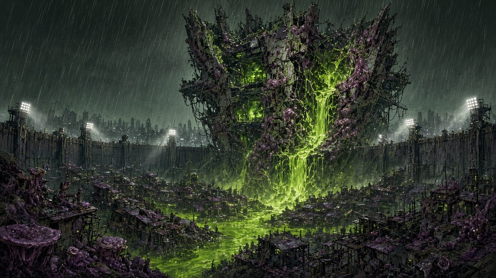

# Options: Background, Feats and Gear

*Mutagen* is set in **Halcyon**, a coastal city whose reactor district flooded and leaked the Mutagen into the water. **G.R.A.F.T.** (Genetic Response And Field Tactics) won the cleanup contract and licenses Mutants as freelancers. **Ostrander**, the security firm that ran the Lockdown camps, hunts unlicensed Mutants with antimutagen weapons. The **Children of the Bloom** worship the Mutagen and want everyone to drink. You can use the Mutant in any 5e world instead: the Mutagen can be a wizard's failed elixir, a meteor's dust or an aberrant god's blood.

## Background: GRAFT Freelancer

You signed a waiver you didn't read, took a number and walked into the Spill. GRAFT pays per job and per Sample.

- **Skill Proficiencies:** Survival, and one of Athletics, Investigation or Medicine
- **Tool Proficiencies:** Thieves' tools or tinker's tools
- **Languages:** One of your choice
- **Equipment:** A GRAFT licence card, a gas mask, a scanner, a set of common clothes, and a pouch containing 15 gp

**Feature: Contractor's Licence.** GRAFT field offices give you a cot, a hot meal and basic repairs for free, and they'll buy Samples (see Gear) at fair prices. Licensed checkpoint guards let you through the Lockdown cordon without questions, though Ostrander patrols won't.

**Suggested Characteristics.** Use the Soldier or Folk Hero tables from the SRD, or roll below.

| d6 | Why you took the job |
|:-:|:--|
| 1 | Your family is still somewhere inside the cordon. |
| 2 | GRAFT pays for the treatments that keep you stable. |
| 3 | You want to know what the Mutagen is doing to you. |
| 4 | Ostrander would have put you in a camp otherwise. |
| 5 | The money. Honestly, the money. |
| 6 | The Bloom spoke to you once. You're trying to forget what it said. |

## Feats

These feats suit any class, but describe the Mutagen working on a non-Mutant (or a Mutant leaning further in).

**Mutagenic Initiate.** *Prerequisite: Constitution 13 or higher.* The Mutagen has started on you.
- You learn one Surge built from a base Shape and a base Effect. You have a Flux Limit of 1 and use the Surge rules as a Mutant (Surge dice 1d6, 2d6 at 5th character level, 3d6 at 11th, 4d6 at 17th; Constitution is your Surge ability). You don't Prime; your Flux resets on a short or long rest. If you are a Mutant, instead your Flux Limit increases by 1 and you learn one extra Surge.
- You can use Regeneration (1d8 + your Constitution modifier) once per long rest.

**Chrome Graft.** You install one implant. Choose a Mutation tree: you gain its Root and one of its Tier I Mutations. A non-Mutant doesn't gain the Root's Surge parts and uses Constitution for any save DC (8 + proficiency bonus + Constitution modifier). Increase one ability score of your choice by 1.

**Hardened Survivor.** *Prerequisite: Mutant.* Increase your Constitution by 1. When you Overload, you take no damage, and when you roll a Scar or Fault you can reroll once.

**Living Weapon.** *Prerequisite: Mutant.* Increase your Strength or Dexterity by 1. Your natural weapon damage die increases by one size (d8 to d10, d10 to d12), and once per turn when you hit with one you can grapple or shove the target as part of the hit.

**Field Surgeon.** Increase your Intelligence or Wisdom by 1. When you use Regeneration, a healer's kit, or a spell that restores hit points to a creature, it regains extra hit points equal to your proficiency bonus. You can stabilise a creature as a bonus action.

## Gear

Prices are in gold pieces for any 5e world; in Halcyon read "gp" as "Scrip".

**Mutagen Gear**

| Item | Cost | Weight | Description |
|:--|:-:|:-:|:--|
| GRAFT stim | 25 gp | — | Action: drink or inject to regain 1d4 + 1 hit points (2d4 + 2 for a Mutant, whose body takes it better). |
| Damper | 50 gp | — | Bonus action: lower your Flux by 2. Only once per short rest. |
| Antimutagen dart | 50 gp | — | Thrown (20/60). On a hit, a Mutant loses one Primed Surge (its choice); other creatures take 1d4 poison damage. |
| Gas mask | 20 gp | 1 lb. | Advantage on saves against inhaled poisons, gases and spores. |
| Scanner | 50 gp | 2 lb. | Detects heat, motion and the Mutagen within 60 ft (through 1 ft of stone or a thin sheet of metal). |
| Hack deck | 50 gp | 2 lb. | Proficiency-like +2 to checks to bypass electronic locks and devices; required to do so without the Mind tree. |
| Breach kit | 30 gp | 5 lb. | Advantage on checks to force doors and locks. |
| Clinic visit | 500 gp | — | Removes one Scar or Fault. |
| Sample splice | 100 gp | — | Install a harvested Sample (see below). |

**Weapons of Halcyon.** Use SRD weapons for scavenged gear: a rebar club is a mace, a pipe-axe a greataxe, a chainsaw a greatsword (loud), a pistol a hand crossbow (piercing, 30/120, reload 6), a rifle a heavy crossbow (100/400), a shotgun a heavy crossbow with range 30/90 that doesn't impose disadvantage when you fire it within 5 ft of a hostile creature. If your table uses the SRD's firearms, use those instead.

**Weapon Mods** (one per weapon, 100 gp each; a mod makes the weapon count as magical for overcoming resistance)

| Mod | Effect |
|:--|:--|
| Keen Edge / Hollow-point | The weapon scores a critical hit on a roll of 19 or 20 (doesn't stack with other crit-range features; use the best). |
| Shock Coil | The weapon's damage becomes lightning; on a critical hit the target can't take reactions until the start of its next turn. |
| Incendiary | The damage becomes fire; on a critical hit the target takes 1d6 fire damage at the start of its next turn. |
| Venom Channel | The damage becomes poison; on a critical hit the target is poisoned until the end of its next turn. |
| Weighted | On a critical hit the target is knocked prone (Huge or smaller). |
| Suppressor | Attacking with the weapon doesn't reveal your position. |
| Smart-Link | +1 to attack rolls with the weapon. Chrome: needs 5 gp of upkeep a week. |

**Samples.** Some Mutagen creatures (marked *Sample* in the Bestiary) leave a harvestable gland, crystal or chip. With a Sample splice, a Mutant can learn the Sample's Surge (a Shape + Effect it lists, even one whose Root they lack) as an extra Surge known. A Mutant can carry one Sample Surge at a time.
