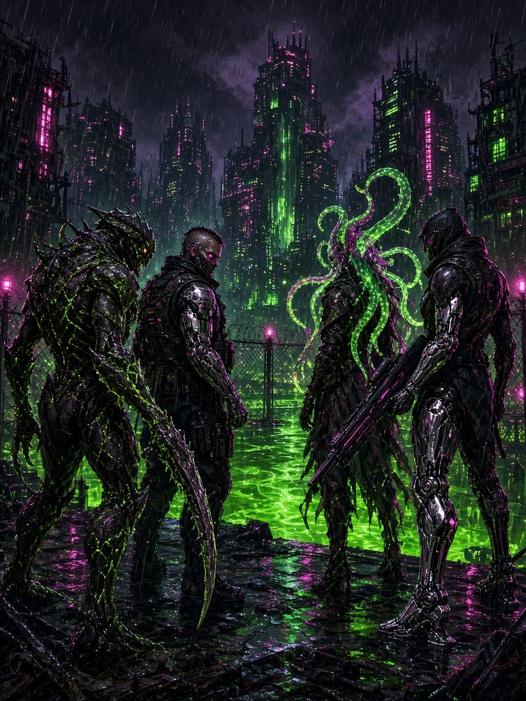

# BeelzRPG — MUTAGEN

**Mutagen** is a tabletop RPG of body-horror, chrome, and bad decisions in the quarantined megacity of Halcyon. No races, no classes: the Mutagen turns you into one of five **Base Forms**, and you grow along its **Augment trees** as flesh (**Bio**) or bolted-on metal (**Chrome**). Twice in your career you **Evolve** into something monstrous. In combat, your body **Surges**: dice pick a few powers from everything you've become, and every one you use pushes you toward **Overload**.

- **One roll:** d20 + Stat (+ Rank) vs a target number. Players roll both attacks *and* defenses.
- **Emotive stats:** **Grit, Moxie, Nerve, Gumption, Chutzpah.**
- **Five Base Forms:** Juggernaut, Skitter, Oracle, Alembic, Siren. Each sets a +3/+2/+1 stat spread and a primary, secondary and tertiary tree.
- **Six 10-node skill trees:** Hide, Limbs, Senses, Glands, Wiring, Mind, plus two Form-exclusive Evolution nodes per Form.
- **Evolutions at levels 4 and 7:** huge stat jumps, +1 Prime, a bigger Sequence die, an always-ready **Signature Surge**, and a new body. Level 10 is your **Final Form**.
- **Surges:** build powers from **Shape + Effect + Twist** parts; your **Sequence die** decides which are ready each fight.
- **Flux & Overload:** power has a price, rolled on the Bloom or Glitch tables.
- **10 missions, 10 levels.**

**The whole rulebook:** [Mutagen_Rulebook.pdf](https://xenodorian.github.io/BeelzRPG/rulebook/Mutagen_Rulebook.pdf) (print-ready, with art) · [Markdown](rulebook/Mutagen_Rulebook.md). One numbered book with Parts, a full contents and a glossary, compiled from the chapters below. See [Rulebook and chapters](#rulebook-and-chapters).

**Everything in one file:** [Mutagen.html](https://xenodorian.github.io/BeelzRPG/Mutagen.html) ([download](https://github.com/xenodorian/BeelzRPG/raw/main/dist/Mutagen.html)): the whole rulebook with contents and search, the Character Builder, the Arcade and the printable sheet, in one offline HTML file (about 1.8 MB). See [Single-file edition](#single-file-edition).

## Read the Game

| # | Chapter |
|---|---|
| 0 | [Introduction & Setting](chapters/00_Introduction.md) |
| 1 | [Core Rules](chapters/01_Core_Rules.md) |
| 2 | [Character Creation](chapters/02_Character_Creation.md) |
| 2A | [Base Forms & Evolution](chapters/02A_Forms_and_Evolution.md) |
| 3 | [Augment Trees](chapters/03_Augment_Trees.md) · [Hide](chapters/03_Trees/Hide.md) · [Limbs](chapters/03_Trees/Limbs.md) · [Senses](chapters/03_Trees/Senses.md) · [Glands](chapters/03_Trees/Glands.md) · [Wiring](chapters/03_Trees/Wiring.md) · [Mind](chapters/03_Trees/Mind.md) |
| 4 | [Surges & the Sequence](chapters/04_Surges.md) |
| 5 | [Flux & Overload](chapters/05_Flux_and_Overload.md) |
| 6 | [Combat & Conditions](chapters/06_Combat.md) |
| 7 | [Advancement](chapters/07_Advancement.md) |
| 8 | [Gear](chapters/08_Gear.md) |
| 9 | [Running the Game (GM)](chapters/09_Running_the_Game.md) |
| 10 | [Threats](chapters/10_Threats.md) |
| 11 | [Starter Mission: *Pumpstation 9*](chapters/11_Starter_Mission.md) |
| 12 | [Quick Reference](chapters/12_Quick_Reference.md) |
| 13 | [Character Building Guide](chapters/13_Character_Building_Guide.md) |
| 14 | [Appendix: Arcade vs Tabletop](chapters/14_Arcade_vs_Tabletop.md) |
| 15 | [Glossary](chapters/15_Glossary.md) |
| 📕 | **[The compiled Rulebook](rulebook/Mutagen_Rulebook.md)** · [PDF](https://xenodorian.github.io/BeelzRPG/rulebook/Mutagen_Rulebook.pdf) |
| — | [Character Sheet (Markdown)](sheets/Character_Sheet.md) · [Printable HTML](sheets/Character_Sheet.html) |
| — | **[Character Builder (web app)](https://xenodorian.github.io/BeelzRPG/builder/)** · [offline file](builder/index.html) |
| — | **[Arcade: Gauntlet mode (web game)](https://xenodorian.github.io/BeelzRPG/arcade/)** · [offline file](arcade/index.html) · [how it works](#arcade-gauntlet-mode) |

**New to the game?** Read chapters 0, 1, 2A and 12, grab a pregen from chapter 11, and play. **Making your own?** Use the [Character Builder](https://xenodorian.github.io/BeelzRPG/builder/) or follow [chapter 13](chapters/13_Character_Building_Guide.md).

## Arcade: Gauntlet mode
**[Play it](https://xenodorian.github.io/BeelzRPG/arcade/)** (or open `arcade/index.html` offline). It's a solo battle simulator built on the real rules: you run a whole party through ten levels of fights back to back.
- **Difficulty is party size:** Easy fields 5 freelancers, Medium 4 and Hard 3. Enemies scale with the rules in ch 10 (the minion budget for the party size, Boss HP and damage × party ÷ 4) plus a threat factor of ×1.0, ×1.22 and ×1.38. On level 1 the extra threat is halved, and on level 2 it's three-quarters.
- **Your party:** start with character creation, then fill each slot.
  - Ways to fill a slot: quick-create (Form, dump, Origin, Kit, Materials, Surges, Knacks), random, a pregen, a character saved in the [Character Builder](builder/index.html), or an imported JSON file.
  - You can save, load, delete, export and import single characters (they share the builder's saved list) and whole named parties.
  - Everyone starts at level 1. Higher-level imports are fitted down.
- **Each level:** a **minion fight** → a **Breather** (half HP, Flux 0) → a **boss fight** → a **level-up** → a **Lockdown** (full HP, injuries cleared, kit restocked).
  - The real Bosses appear at levels 1 (Brood Matriarch), 5 (Warden Krell) and 10 (**Patient Zero**). The other levels use a centrepiece whose Boss Rating matches the level.
- **Battle map (v2):** every fight is played on a virtual tabletop: a themed backdrop (pump hall, streets, camp, clinic, rust yard, bloom) under a square grid (1 square = 5 ft, diagonals = 1) with obstacles that block movement and line of sight.
  - Tokens show portraits, an HP ring and condition badges. Move freelancers by clicking a lit square, tapping, or the arrow keys + Enter; squares that provoke an Opportunity Strike are marked, and "Move carefully" halves speed to avoid them.
  - Ranges are real squares: attacks and Surges light up their range (long range fainter), valid targets glow, Areas preview their footprint (allies caught shown in red) with a "Best aim" button, and out-of-range options are greyed out with the reason.
  - Enemies move on the grid too: melee closes in and flanks, shooters keep their distance, Areas aim for clusters.
- **Turn-based menus:** a JRPG command menu (Move / Attack / Surges / Churn / Items / Defend & Other / Wait / End Turn, with submenus and Back/Esc) that switches to the next freelancer automatically. A turn-order bar sits on top, a HUD shows the active freelancer and the selected enemy, and the dice log folds away. Enemy turns animate (normal, fast or instant; Space skips). Keyboard, mouse and touch all work, and the layout docks the menu at the bottom on phones.
- **Rules covered:** every roll is shown in the dice log.
  - Prime, Amped doubles, the Wild table, Churn, Signatures, Emergence and Final Form;
  - Flux, Overload and the Bloom/Glitch tables;
  - d20 + stat + Rank against Guard, and the player rolling Dodge, Endure or Resist against the enemy's TN;
  - conditions, Down, death marks and injuries; Opportunity Strikes, reach, long range and shooting in melee;
  - enemy traits (Pack, Heavy areas, Leader, Mender, summons, Shift and so on).
- **Level-up:** the primary node is automatic. You pick the secondary/tertiary nodes, new Surges and Signatures, and Knacks (at 3, 6 and 9). Evolutions come at 4 and 7, and Final Form at 10.
- **Losing:** in standard mode you can retry a lost fight from its start. Each retry wears the enemies down a little (Mercy), and the dead are recovered at the next Lockdown with a permanent Scar or Fault. **Permadeath** mode allows no retries and the dead stay dead.
- Runs autosave, mid-battle too: resuming puts every token back where it was. Auto this turn / rest of round / Auto-battle are still there. The design notes and simplifications are in [Current_Work.md](Current_Work.md#arcade-gauntlet-mode-arcade).

## Rulebook and chapters
The rules live in **one place**: the chapter files in `chapters/` (and `chapters/03_Trees/`). They are the source; edit them, never the rulebook.
- `rulebook/Mutagen_Rulebook.md` is **generated** from them by `python3 tools/build_rulebook.py`: Parts, a title page, a full table of contents, numbered sections (§6.4, §10.5 …), the six trees inlined into chapter 3, every link rewritten to the book's own anchors, repeated art and per-file navigation dropped. Text wrapped in `<!-- chapters-only -->…<!-- /chapters-only -->` appears only in the chapter files.
- `rulebook/Mutagen_Rulebook.pdf` is printed from it with headless Chrome: `CHROME=/usr/bin/google-chrome node tools/rulebook_pdf.js` (puppeteer-core). It checks every image and internal link and stamps `rulebook/.pdf_source.sha256`.
- **Sync test:** `python3 tools/build_rulebook.py --check` fails if the Markdown book or the PDF is older than the chapters.
- The single-file edition's Rules tab renders the same compiled book (same order, numbers and Parts).
- Coherence fixes (a duplicated passage, a contradiction) go into the chapters; the book picks them up on the next build.

## Single-file edition
`dist/Mutagen.html` (also published as [/Mutagen.html](https://xenodorian.github.io/BeelzRPG/Mutagen.html)) is the whole game in one self-contained HTML file. Open it from disk or a USB stick; it needs no internet.
- **Tabs:** 📖 Rules (the compiled rulebook, numbered, by Part, a contents sidebar with every section, search with `/`), 🧬 Builder, ⚔ Arcade and 📝 Sheet.
- Builder and Arcade run in the same page and **share saves** (localStorage), as on the website. Builder share links (`Link` button) point at the file itself.
- All scripts, styles and art are inside the file (art downscaled to 900 px JPEG).
- **Rebuild it** after changing chapters, the builder or the arcade: `python3 tools/build_single.py` (Python 3; Pillow optional, for smaller art). It writes `dist/Mutagen.html` and `Mutagen.html`.
- **Test it:** `CHROME=/usr/bin/google-chrome node tools/single_test.js` (puppeteer-core) opens it from `file://` with the network cut off and checks every section: links, search, builder save, an arcade auto-run that uses the builder's save, share links and the phone layout.

## Contributing
Start with [Current_Work.md](Current_Work.md): task list, design log, style guide and known issues (the glossary is [chapter 15](chapters/15_Glossary.md)). After editing chapters, run `python3 tools/build_rulebook.py`, `node tools/rulebook_pdf.js` and `python3 tools/build_single.py`. One chapter per file, so you can work in parallel without conflicts.

*Art in `art/` is AI-generated placeholder art.*
