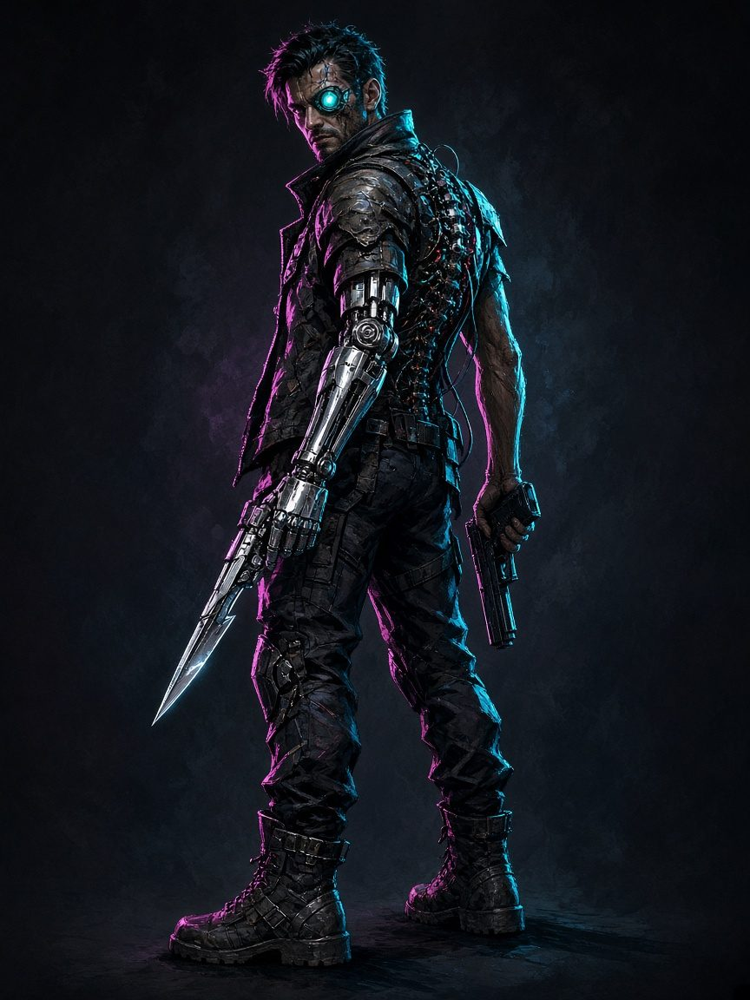

# 3. Augment Trees

Your Augments are your class, your race, and your story. There are **six trees**. Each tree is a part of the body you've changed; each can be **grown (Bio)** or **installed (Chrome)**.

## How Trees Work
- **Nodes.** You take **2 nodes at level 1** and **1 node every level after** (11 at level 10). A node is taken once.
- **Root first.** You must take a tree's **Root** before any other node in it. After the Root, take nodes in any order.
- **Apex.** A tree's Apex requires **level 7+** and **three other nodes** in that tree.
- **Scaling.** Nodes scale with your **Rank**; you never need a "greater" version.
- **Push.** Some nodes say **Push**: you may gain **1 Flux** to get the extra effect ([Chapter 5](05_Flux_and_Overload.md)).
- **Unlocks.** Each tree unlocks **Surge parts** ([Chapter 4](04_Surges.md)) the moment you take its Root.
- **Respec.** When you level up, you may swap one node for another you qualify for (the clinic rips it out).

## Form: Bio or Chrome
When you take a tree's Root, choose its **Form**. Every node in that tree shares it. Form changes how it looks and adds the rules below.

| Form | Looks like | Perk | Cost |
|---|---|---|---|
| **Bio** (grown) | Chitin, scales, extra eyes, glands, tentacles, glowing veins | **Knit:** when you take a Breather, regain extra HP equal to **Rank × your number of Bio trees**. | Your Overloads roll on the **Bloom** table. |
| **Chrome** (installed) | Plates, pistons, optics, ports, wiring, servo-arms | **Firmware:** once per combat, right after you Prime, you may swap one Primed Surge for any Surge you know that uses a part unlocked by a Chrome tree. | Your Overloads roll on the **Glitch** table. You roll defense with **disadvantage against Shock** attacks. **Upkeep:** 25 Scrip per Chrome tree each mission, or start the mission with +1 Flux per unpaid tree. |
| **Splice** (you have both) | Meat and metal fighting for the same body | Overload: roll on **both** tables, then choose one result. | Your Flux Limit is **−1**. |

## Tree Summary

| Tree | Stats | Role | Unlocks |
|---|---|---|---|
| **Hide** | Grit | Tank, protector | Pulse (shape), Quake, Shell |
| **Limbs** | Grit / Moxie | Melee, grappler, mover | Wave (shape), Snare |
| **Senses** | Nerve | Sniper, scout, spotter | Glare, Veil |
| **Glands** | Gumption / Grit | Chemist, healer, attrition | Burst (shape), Toxin, Corrode, Mend |
| **Wiring** | Moxie | Speed, reflexes, shock | Shock, Blaze, Haste |
| **Mind** | Nerve / Chutzpah | Psionics, hacking, control | Dread, Link |

---

## HIDE
*Bio: chitin plates, scales, rubbery blubber, bark-skin. Chrome: dermal plating, kinetic mesh, ablative shell.*  
**Unlocks:** Pulse, Quake, Shell.

- **Root — Plating.** +1 Armor (**+2 from Rank 3**). Armor from all sources maxes at 4.
- **Thick.** +2 Max HP per level (count past levels too).
- **Barbs.** When an enemy's melee attack damages you, it takes **2 × Rank** damage.
- **Adaptive.** When you take Blaze, Shock, Toxin, Corrode, or Psychic damage, you resist that type (half damage) until combat ends. One type at a time; a new type replaces the old.
- **Bulwark.** *Reaction:* when an ally within 10 ft is targeted by a Single attack, you become the target instead and roll your own defense. **Push:** roll it with advantage.
- **Apex — Unbreakable.** Once per round, when you fail a defense roll, **Push** to succeed instead. You can't be knocked Prone or moved against your will.

## LIMBS
*Bio: claws, mantis blades, tentacles, extra arms, digitigrade legs. Chrome: piston arms, mono-blades, grapple lines, servo-arms, hydraulic legs.*  
**Unlocks:** Wave, Snare.

- **Root — Natural Weapons.** Claws, blades, or pistons: a melee weapon (**d8**, Grit or Moxie) that can't be disarmed and doesn't need a free hand.
- **Extra Arm.** A third limb. Hold one more item, and draw, stow, or interact without using your Quick action. Once per turn, when you hit with a melee attack, **Push** to knock the target Prone (not Huge creatures).
- **Grapnel.** Your melee reach is 10 ft. As your Move, you can pull yourself up to 30 ft to any surface you can see, or yank an unheld object to your hand.
- **Crusher Grip.** Once per turn when you hit with a natural weapon, the target is **Held**. Huge creatures and Bosses require a **Push**.
- **Spring Legs.** +10 ft speed. Jump 20 ft long or 10 ft high as part of your move, climb at full speed, and take half falling damage.
- **Apex — Flurry.** When you take the Attack action with natural weapons, make a second attack with half the damage dice (round up).

## SENSES
*Bio: compound eyes, pit organs, bat ears, whiskers, a third eye. Chrome: optic suites, targeting HUD, radar, audio filters.*  
**Unlocks:** Glare, Veil.

- **Root — Keen.** See in darkness out to 60 ft. Advantage on checks to notice hidden things. Bright light can't Blind you.
- **Target Lock.** *Quick:* mark a creature you can see. Once per turn, your attack against it deals **+1 damage die** (one more of that attack's dice). The mark lasts until combat ends or you mark another.
- **Threat Sense.** You and your group can't be surprised. *Reaction:* when an ally within 30 ft makes a defense roll, add your Nerve to it (declare before rolling).
- **Analyzer.** You can **Analyze** as a Quick action once per turn.
- **Long Sight.** Double the range of your ranged attacks and ranged Surges. Ignore partial cover. Read lips at 300 ft.
- **Apex — Deadeye.** Your ranged attacks Crit on 18–20. Once per round, **Push** to reroll a missed attack.

## GLANDS
*Bio: venom sacs, acid glands, healing bile, spore pods. Chrome: chem injectors, nanite reservoirs, drug pumps, nozzle ports.*  
**Unlocks:** Burst, Toxin, Corrode, Mend.

- **Root — Spit.** A ranged natural attack (**d8**, 30 ft, Nerve or Grit), Toxin or Corrode damage (choose each time). Advantage on Endure against poison.
- **Regenerate.** At the start of your turn, if you're at half HP or less (and not Down), regain **Rank + 1** HP.
- **Stim Gland.** *Action* (or *Quick* with **Push**): you or a creature you touch regains **Rank d6 + Gumption** HP and ends Burning or Poisoned. Twice per Breather.
- **Adrenal Dump.** The first time each combat you drop to half HP or less, gain **2 × Rank + Grit** temporary HP and advantage on your next attack.
- **Purge.** Once per combat, *Quick:* lose Flux equal to **Rank + 1** and take that much damage (ignores Armor).
- **Apex — Living Pharmacy.** Stim Gland affects you and every ally within 15 ft at once. Your Mend Surges cost no Flux.

## WIRING
*Bio: hyper-fast nerves, eel-organs, adrenal crystals. Chrome: reflex boosters, synthetic muscle, capacitor banks, plasma coils.*  
**Unlocks:** Shock, Blaze, Haste.

- **Root — Quickened.** +10 ft speed. You can **Dash** as a Quick action. Your group has advantage on initiative checks.
- **Reflex Spike.** *Reaction:* when you succeed on a Dodge against a melee attack, make one weapon attack against the attacker.
- **Capacitor.** Once per turn when you hit with a melee attack, deal **+1 damage die** (one more of that attack's dice) as Shock. **Push:** the target is also Dazed.
- **Slipstream.** You never provoke Opportunity Strikes, can move through enemies' spaces, and take **no** damage when you succeed on a Dodge against an area attack.
- **Overclock.** Once per combat, take one extra Action on your turn, then gain 1 Flux.
- **Apex — Blur.** You get two Moves each turn. If you've moved 20+ ft this turn, roll Dodge with advantage until your next turn.

## MIND
*Bio: swollen cortex, psionic nodules, pheromone glands, a voice that echoes. Chrome: neural coprocessor, wetware deck, voice modulator, antenna crown.*  
**Unlocks:** Dread, Link.

- **Root — Uplink.** Speak mind-to-mind (Bio) or by encrypted radio (Chrome) with willing creatures within 300 ft. **Mind Spike:** a ranged attack (**d8**, 60 ft, Nerve or Chutzpah), Psychic damage.
- **Intrude.** *Action:* Gumption or Chutzpah + Rank vs a creature's TN (or a device's DC): read its surface thoughts, or seize an unattended device for 1 minute. In combat, a Mook machine obeys you until the end of next round; any other machine is Dazed.
- **Puppet.** *Action,* **Push:** Chutzpah + Rank vs the TN of a non-Boss creature. On success, it immediately moves up to its speed where you choose, or makes one attack against a target you choose.
- **Iron Will.** Advantage on Resist. Allies within 30 ft get +1 to Resist.
- **Precog.** *Reaction,* **Push:** when you or an ally within 30 ft makes a d20 roll, roll another d20; they choose which to keep.
- **Apex — Hive Mind.** Prime one extra Surge at the start of each combat. Once per round, an ally within 300 ft can use your Nerve or Chutzpah in place of theirs for one roll.

---

## Building With Trees: Sample Archetypes

| Archetype | Trees | Plays like |
|---|---|---|
| **Brick** | Hide + Limbs | Stands in the doorway, holds enemies, hits back |
| **Stalker** | Limbs + Wiring | Darts in, Dazes, darts out |
| **Spotter** | Senses + Mind | Long-range damage, marks targets, protects minds |
| **Doc** | Glands + Mind | Heals, poisons, and talks everyone down |
| **Sparkplug** | Wiring + Glands | Burns and shocks crowds with Bursts |
| **Mouth** | Mind + Hide | Taunts everything, then survives it |
