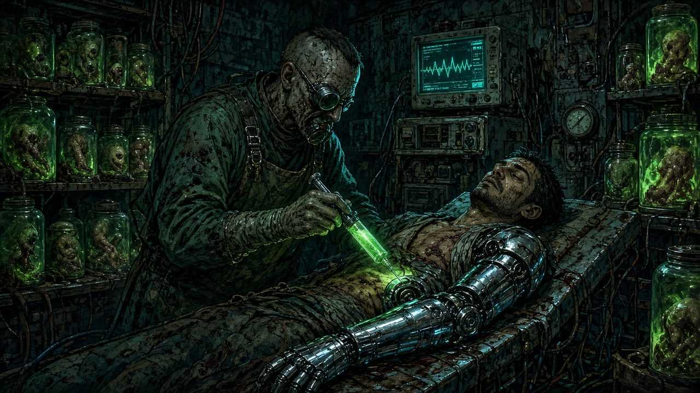

# 8. Gear

Gear in Mutagen is **modular**: every weapon is a **Frame** plus up to **one Mod**. Damage always scales with your Rank, so a good knife stays useful all campaign.

**Money** is **Scrip** (GRAFT company credit, accepted almost everywhere in Halcyon).

## Weapons
**Damage = Rank × die + attack stat.** A level 5 freelancer (Rank 3) with a Heavy weapon and Grit +3 deals 3d10+3.

### Frames
| Frame | Die | Stat | Range | Hands | Notes | Cost |
|---|---|---|---|---|---|---|
| **Unarmed** | d4 | Grit | Melee | — | Always available | — |
| **Light melee** (knife, baton, hatchet) | d6 | Moxie or Grit | Melee / thrown 20 ft | 1 | Concealable | 15 |
| **Standard melee** (machete, bat, blade) | d8 | Grit or Moxie | Melee | 1 | | 30 |
| **Heavy melee** (sledge, chainsaw, pipe-axe) | d10 | Grit | Melee | 2 | | 40 |
| **Natural weapons** | d8 | Grit or Moxie | Melee | — | From Limbs Root; can't be disarmed | node |
| **Pistol** | d6 | Nerve | 60 ft | 1 | Concealable | 40 |
| **Rifle** | d8 | Nerve | 120 ft | 2 | | 80 |
| **Shotgun** | d10 | Nerve | 30 ft | 2 | Loud | 60 |
| **Launcher** | d6 | Nerve | 90 ft | 2 | **Area** (10-ft radius); 3 shots per mission | 150 |

**Area weapons** work like area Surges: one attack, compare to each Guard, half damage on a miss.

### Mods (one per weapon, 100 Scrip each)
| Mod | Effect |
|---|---|
| **Keen Edge / Hollow-point** | Crit on 19–20. |
| **Shock Coil** | Damage becomes Shock; on a Crit, the target is Dazed. |
| **Incendiary** | Damage becomes Blaze; on a Crit, the target is Burning. |
| **Venom Channel** | Damage becomes Toxin; on a Crit, the target is Poisoned. |
| **Acid Etch** | Damage becomes Corrode; on a Crit, the target is Exposed. |
| **Weighted** | On a Crit, the target is knocked Prone (not Huge). |
| **Suppressor** | Silent. Shooting doesn't reveal your position. |
| **Scope** | Double range; ignore partial cover. |
| **Pole Haft** | Melee reach 10 ft. |
| **Smart-Link** | +1 to attack rolls. Counts as Chrome (needs Upkeep: 25 Scrip per mission). |

## Armor
Armor reduces each hit by its value. **Total Armor (gear + Augments) maxes at 4.**
| Armor | Armor | Notes | Cost |
|---|---|---|---|
| **Light** (padded jacket, scavenged plates) | 1 | — | 30 |
| **Heavy** (riot plating, hazmat shell) | 2 | Speed −5 ft; disadvantage on stealth | 120 |
| **Shield** (door, riot shield) | +1 | Uses one hand | 40 |

## Kit
| Item | Effect | Cost |
|---|---|---|
| **Medkit** | 3 charges for the Patch action | 25 |
| **Stim** | *Quick:* regain Rank d6 HP | 30 |
| **Damper** | *Quick:* lose 2 Flux. One per combat. | 50 |
| **Frag grenade** | *Action:* Nerve attack, 10-ft radius within 30 ft, Rank d6 Kinetic, **Area** | 40 |
| **Flashbang** | As frag, but no damage; hit creatures are **Blinded** | 40 |
| **EMP grenade** | As frag, but Shock; machines hit are **Dazed** (Chrome freelancers in it defend with disadvantage) | 60 |
| **Gas mask** | Advantage on Endure against gas and spores | 20 |
| **Breach kit** | Advantage on checks to force doors and locks | 30 |
| **Hack deck** | Required for hacking checks without the Mind tree | 50 |
| **Scanner** | Detects heat, motion, and Mutagen within 60 ft | 50 |
| **Grapnel & 50 ft line** | Climbing aid | 10 |
| **Ration** | A day of food; cures **Ravenous** | 5 |
| **Clinic visit** | Remove a Scar or Fault | 200 |
| **Sample splice** | Install a Sample as a Surge ([Advancement](07_Advancement.md#samples)) | 100 |

## Starting Kits
Every kit includes: **Light armor**, GRAFT ID, radio, flashlight, 2 rations, 1 Damper.
| Kit | Contents |
|---|---|
| **Bruiser** | Heavy melee weapon, Medkit, Grapnel |
| **Gunhand** | Rifle or Shotgun, Pistol, Frag grenade |
| **Sneak** | Two Light melee weapons, Pistol with Suppressor, Breach kit |
| **Medic** | Pistol, Standard melee weapon, 2 Medkits, 2 Stims |
| **Face** | Concealed Pistol, Light melee weapon, Hack deck, Flashbang, +50 Scrip |
| **Wardrunner** | Standard melee weapon, Shotgun, Gas mask, Scanner |
