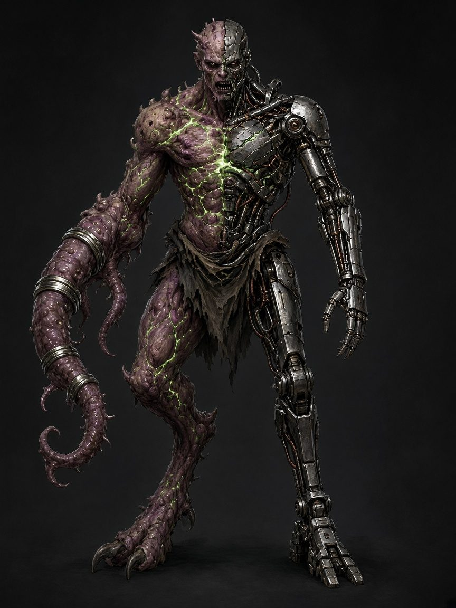

# 13. Character Building Guide

This chapter walks you from a blank sheet to a finished level 1 freelancer, then up to level 10. It tells you **what to pick and in what order**. The rules themselves live in chapters 1–8; when they disagree with this guide, they win.

**Prefer clicking?** The [Character Builder](../builder/index.html) ([online](https://xenodorian.github.io/BeelzRPG/builder/)) follows these steps, checks legality, and prints a sheet.

## Everything on Your Sheet

| Component | What it is | Step | Rules |
|---|---|---|---|
| Concept, Drive | Who you are, what you want | 1, 10 | [Ch 2](02_Character_Creation.md) |
| Stats | Grit, Moxie, Nerve, Gumption, Chutzpah | 2 | [Ch 2](02_Character_Creation.md#the-five-stats) |
| Origin | Background: 1 Knack + 1 Perk | 3 | [Ch 2](02_Character_Creation.md#origins-roll-d6-or-choose) |
| Knacks | Narrow specialties; add Rank to checks | 4 | [Ch 1](01_Core_Rules.md#knacks) |
| Augments | Trees, Form, nodes | 5 | [Ch 3](03_Augment_Trees.md) |
| Surges + Sequence | Your random combat powers | 6 | [Ch 4](04_Surges.md) |
| Gear + Scrip | Kit, weapons, armor, money, Upkeep | 7 | [Ch 8](08_Gear.md) |
| Derived numbers | Rank, HP, Armor, Speed, defenses, Flux Limit, attacks | 8 | [Ch 2](02_Character_Creation.md#derived-numbers-level-1) |
| Juice, trackers | Reward tokens; Flux, Death marks, Breathers, Last Gasp | 9 | [Ch 1](01_Core_Rules.md#juice), [Ch 5](05_Flux_and_Overload.md) |
| Scars, Faults, Injuries, Samples | Things that happen to you in play | later | [Ch 5](05_Flux_and_Overload.md), [Ch 6](06_Combat.md#injury-table-d6), [Ch 7](07_Advancement.md#samples) |

---

## Level 1, Step by Step

### 1. Concept
One sentence with a **job**, a **body change**, and a **flaw**: *"Ex-Ward electrician who rewired her own nerves and can't stop touching live cables."* Pick a starting role from the [archetypes](#mix-and-match-archetypes) if you're stuck.

### 2. Stats
Assign **+3, +2, +1, +0, −1**, one each. Put +3 in the stat you'll **attack with**:

| You want to... | Attack stat | Also good |
|---|---|---|
| Hit hard in melee | Grit (also HP, Endure) | Moxie |
| Fight fast, dodge everything | Moxie (also Dodge, initiative) | Grit |
| Shoot, blast areas | Nerve (also Resist, **Flux Limit**) | Moxie |
| Heal, hack, poison | Gumption (Spit, Patch, Analyze) | Nerve |
| Talk, scare, lead | Chutzpah (Mind Spike, Dread, Taunt, Rally) | Nerve |

Don't dump Nerve unless you plan to Surge rarely: −1 Nerve means a Limit of 4. Your lowest defense will fail about half the time.

### 3. Origin
Roll d6 or choose. Write its **Knack** and **Perk**. Perks with numbers: *Corporate Washout* +100 Scrip; *Lab Escapee* +1 Surge known; *Clinic Rat* +Rank to Patch; *Ward Militia* +2 on group initiative.

### 4. Knacks
Your Origin gives one; write **two more** (3 total). Narrow and concrete: *Sewer Routes*, not *Survival*. You gain one more at levels 4 and 8.

### 5. Augments
Take **two nodes**. A tree's **Root** must come first, so you take either:
- **Two Roots** (two trees, more Surge parts), or
- **one Root + one node** in the same tree (deeper, fewer parts).

For **each tree**, pick its **Form** when you take the Root. Every later node in that tree shares it.

| You have | You are | Perk | Cost |
|---|---|---|---|
| Only Bio trees | **Bio** | Knit: +Rank HP per Bio tree after each fight and Breather | Bloom table |
| Only Chrome trees | **Chrome** | Firmware: swap one Primed Surge per fight | Glitch table, disadvantage vs Shock, **25 Scrip Upkeep per Chrome tree per mission** |
| Both | **Splice** | Knit (counting Bio trees) + Firmware (Chrome-tree parts) + roll both Overload tables, choose one | Chrome's costs above, **Flux Limit −1** |

**What each Root unlocks** (you can build Surges with these parts from now on): Hide → Pulse, Quake, Shell · Limbs → Wave, Snare · Senses → Glare, Veil · Glands → Burst, Toxin, Corrode, Mend · Wiring → Shock, Blaze, Haste · Mind → Dread, Link.

Three Roots give you a weapon-like attack: **Natural Weapons** (Limbs, d8 melee, Grit/Moxie), **Spit** (Glands, d8, 30 ft, Nerve/Gumption) and **Mind Spike** (Mind, d8, 60 ft, Nerve/Chutzpah).

### 6. Surges and the Sequence
Build **3 Surges** (4 for a Lab Escapee) and write them in Sequence slots **1–3**. Your **Sequence die is d4**, so slot **4 is Wild** (a Lab Escapee fills it). Prime is **2**.

**The Surge recipe:**
1. **Shape:** any base Shape (**Strike, Bolt, Infuse**) or one your Roots unlocked.
2. **Effect:** a **damage Effect** (base: **Kinetic**) for Strike/Bolt/Burst/Wave/Pulse, **or** an **Infuse Effect** for Infuse. Never mix.
3. **Twist** (optional): **one** at Rank 1–2, **two different** from Rank 3. Each must match the Shape (*Chain*: Strike/Bolt; *Linger*: area Shapes; *Leech*, *Overcharge*: damage only; *Sure*, *Reach*, *Hush*: any).
4. **Cost:** 1 Flux + 1 per Twist.
5. **Name it and describe it** in your Form's look.

**Numbers on a Surge:**

| Shape | Attack | Damage |
|---|---|---|
| Strike | Grit or Moxie + Rank | (Rank+1)d10 + stat |
| Bolt | Nerve + Rank | (Rank+1)d8 + stat |
| Burst / Wave / Pulse | Nerve / Grit or Nerve / Grit + Rank | (Rank+1)d6 (no stat) |
| Infuse | no roll | per Effect |

Add **+1 die** for Kinetic and **+2 dice** for Overcharge. **Dread** Surges may attack with Chutzpah.

**A good first three:** one **reliable damage** Surge in your best stat, one **control** Surge (a rider that fits your trees), and one **Infuse** or **area** Surge for the team. Avoid three that all need the same situation.

### 7. Gear and Scrip
Take one **Starting Kit** ([Ch 8](08_Gear.md#starting-kits)). All include Light armor (Armor 1), GRAFT ID, radio, flashlight, 2 rations and 1 Damper. Then take **50 Scrip** (+100 Corporate Washout, +50 Face kit) and buy from [Gear](08_Gear.md) if you like.
- Weapons: **Damage = Rank × die + stat**; one Mod per weapon (100 Scrip). Natural Weapons can take a Mod; Spit and Mind Spike can't.
- You wear **one** armor (Light *or* Heavy), plus an optional Shield. **Armor max 4**, gear and Hide combined.
- **Upkeep:** 25 Scrip per Chrome tree (and per Smart-Link) each mission. GRAFT prepays your first mission.

### 8. Fill In the Numbers

| Number | Formula |
|---|---|
| **Rank** | ⌈level ÷ 2⌉ (1 at level 1) |
| **Max HP** | 12 + 2 × Grit + 5 × (level − 1); Hide *Thick* +2 × level |
| **Armor** | Light 1 / Heavy 2, Shield +1, *Plating* +1 (+2 from Rank 3); max 4 |
| **Speed** | 30 ft; +10 *Quickened*, +10 *Spring Legs*, −5 Heavy armor |
| **Defenses** | Dodge = Moxie + Rank · Endure = Grit + Rank · Resist = Nerve + Rank |
| **Flux Limit** | 4 + Rank + Nerve, minimum 4; then −1 if Splice |
| **Attack** | stat + Rank; damage Rank × die + stat |
| **Sequence / Prime / Juice** | d4 / 2 / 1 (max 3) |

### 9. Trackers
Mark the boxes you'll use in play: **Flux** (up to your Limit; going over is an Overload), **Death marks** (3), **Breathers** (2 per Lockdown), **Last Gasp** (1 per Lockdown), **Juice** (start each session with 1).

### 10. Drive
Answer: *Why did you take the Mutagen? What do you want before the campaign ends? Who in Halcyon do you owe, or hate?* Give the GM at least one name.

---

## Leveling Up (1–10)
One mission = one level ([Ch 7](07_Advancement.md)). Each level, in order:
1. **+5 Max HP** (+2 more with *Thick*).
2. **+1 node.** Root before other nodes; an **Apex** needs **level 7+** and **3 other nodes** in its tree. New trees are fine at any level (pick their Form).
3. **+1 Surge** into the next empty slot. You may also **rewrite** one Surge.
4. **Optional respec:** swap one node for another you qualify for.
5. Apply the level's extra (table), then recalculate Rank, HP, defenses, Limit, weapon dice.

| Level | Rank | Nodes | Surges | Die | Wild slots | Prime | Extra |
|---|---|---|---|---|---|---|---|
| 1 | 1 | 2 | 3 | d4 | 1 | 2 | 3 Knacks |
| 2 | 1 | 3 | 4 | d6 | 2 | 2 | |
| 3 | 2 | 4 | 5 | d6 | 1 | 2 | Stat boost |
| 4 | 2 | 5 | 6 | d8 | 2 | 2 | +1 Knack |
| 5 | 3 | 6 | 7 | d8 | 1 | **3** | 2 Twists; Plating +2 |
| 6 | 3 | 7 | 8 | d10 | 2 | 3 | Stat boost |
| 7 | 4 | 8 | 9 | d10 | 1 | 3 | Apex unlocked |
| 8 | 4 | 9 | 10 | d12 | 2 | 3 | +1 Knack |
| 9 | 5 | 10 | 11 | d12 | 1 | 3 | Stat boost |
| 10 | 5 | 11 | 12 | d12 | 0 | 3 | Final Form |

- **Stat boost:** +1 to **two different** stats, max +5. Raising Grit raises HP for every level; raising Nerve raises your Limit.
- **Lab Escapee** has one fewer Wild slot (none at level 10). Hive Mind adds +1 Prime.
- **In play** you may also gain: **Scars/Faults** from Overloads (some change numbers: *Hollow Bones*, *Drained Cell*, *Brittle Shell*, *Sticky Relay*), a **Blossom** Knack, *Patch Applied* (+1 Limit), **Injuries** until Lockdown, and **Samples** (a Surge spliced into a Wild slot for 100 Scrip; it may use the Boss's parts).
- **Scrip:** each mission pays 200 + 100 × level; pay Upkeep before the next one.

**Planning tip:** sketch your **Apex** at level 1. You need the Root + 3 nodes by level 7, so a two-tree build can reach one Apex by 7 and a second by about 9.

---

## Mix-and-Match Archetypes
Pick a **pair of trees**, choose each tree's Form, then add any Origin and kit. Six pairs are in [Ch 3](03_Augment_Trees.md#building-with-trees-sample-archetypes); here are more, with a signature Surge from their unlocks.

| Archetype | Trees (suggested Form) | Best stat | Kit | Signature Surge |
|---|---|---|---|---|
| **Bouncer** | Hide + Limbs (Bio) | Grit | Bruiser | Pulse + Quake: everyone around you falls down |
| **Duelist** | Limbs + Wiring (Chrome) | Moxie | Sneak | Strike + Shock + Chain |
| **Sniper** | Senses + Wiring (Chrome) | Nerve | Gunhand | Bolt + Glare + Sure |
| **Plague Doc** | Glands (Bio) + Mind | Gumption | Medic | Burst + Toxin + Linger |
| **Sparkplug** | Wiring (Chrome) + Glands (Bio), Splice | Nerve | Gunhand | Burst + Blaze + Linger |
| **Preacher** | Mind (Bio) + Hide | Chutzpah | Face | Bolt + Dread (Chutzpah) |
| **Wall** | Hide (Chrome) + Senses | Grit | Wardrunner | Infuse + Shell + Sure |
| **Ghost** | Senses + Mind (Chrome) | Nerve | Sneak | Bolt + Kinetic + Hush |
| **Wrangler** | Limbs + Glands | Grit | Bruiser | Wave + Snare |

**Three-tree builds** (third Root at level 2–4) trade depth for Surge variety. One deep tree reaches its Apex soonest.

## Common Mistakes
- **Taking a non-Root node first.** Every tree starts at its Root.
- **Using a part you haven't unlocked.** Only base parts (Strike, Bolt, Infuse, Kinetic) and your Roots' unlocks.
- **Infuse with a damage Effect**, or Bolt with Mend. Infuse only takes Infuse Effects.
- **Wrong Twist:** Chain on a Burst, Linger on a Bolt, Overcharge on Infuse, two Twists before Rank 3, the same Twist twice.
- **Adding the stat to area damage.** Burst, Wave and Pulse roll dice only.
- **Forgetting Splice −1 Limit** or **Chrome Upkeep** (and disadvantage vs Shock).
- **Armor over 4,** or wearing Light and Heavy together.
- **Filling Wild slots.** You can't know more Surges than the table says; Wild slots are supposed to be there (Lab Escapee and Samples aside).
- **Recalculating HP from the new level only.** Grit and *Thick* count for every level.
- **Taking an Apex early.** Level 7+ and three other nodes in that tree.

---

## Worked Example: Dree "Brownout" Ocampo

### Level 1
1. **Concept:** Ex-Ward electrician who rewired her nerves and grew a gut that brews napalm. *Sparkplug.*
2. **Stats:** Moxie +3, Nerve +2, Gumption +1, Grit +0, Chutzpah −1.
3. **Origin:** Ward Militia: *Squad Tactics*; +2 on group initiative, Brace as Quick once per combat.
4. **Knacks:** *Squad Tactics*, *Electrical Repair*, *Rooftop Routes*.
5. **Augments:** Wiring Root *Quickened* (**Chrome**) + Glands Root *Spit* (**Bio**) → **Splice**. Unlocked: Shock, Blaze, Haste, Burst, Toxin, Corrode, Mend.
6. **Sequence (d4, Prime 2):**

| # | Surge | Build | Flux | At level 1 |
|---|---|---|---|---|
| 1 | Sizzle Spit | Bolt + Blaze | 1 | +3, 2d8+2 Blaze, Burning |
| 2 | Brownout | Burst + Shock | 1 | +3 vs each Guard, 2d6 Shock, Dazed |
| 3 | Second Wind | Infuse + Mend | 1 | 2d8+1 HP, ends Burning/Poisoned |
| 4 | *Wild* | | | |

   Firmware can swap in *Sizzle Spit* or *Brownout* (they use Blaze/Shock from her Chrome Wiring); *Second Wind* uses only Bio Glands parts, so it can't be swapped in.

7. **Gear:** Gunhand kit (Rifle, Pistol, Frag grenade) + common items. 50 Scrip; buys a Medkit (25), 25 left. Upkeep 25 for Wiring, prepaid for mission 1.
8. **Numbers:** Rank 1 · HP **12** · Armor **1** · Speed **40** · Dodge **+4**, Endure **+1**, Resist **+3** · Flux Limit **6** (4 + 1 + 2 − 1 Splice) · Juice 1.
   **Attacks:** Rifle +3, 1d8+2 (120 ft) · Spit +3, 1d8+2 Toxin/Corrode (30 ft) · Pistol +3, 1d6+2 (60 ft).
   **Form:** Knit 1 HP (1 Bio tree × Rank 1); Firmware; Overload rolls both tables; disadvantage vs Shock.
9. **Drive:** She took the Mutagen to survive a substation fire. She wants the Ward's grid back on. She owes Scrapjack boss **Tallow** a new spine.

### Level 5
Level-ups: **2** *Overclock* · **3** *Slipstream*, stat boost Nerve +1, Grit +1 · **4** *Purge*, Knack *Chemistry* · **5** *Stim Gland*. Each level added one Surge (4–7). She also bought a Hollow-point Mod for her rifle (100 Scrip).
- **Stats:** Moxie +3, Nerve +3, Gumption +1, Grit +1, Chutzpah −1. **Rank 3.**
- **Nodes (6):** Wiring (Chrome): Quickened, Overclock, Slipstream · Glands (Bio): Spit, Purge, Stim Gland.
- **Numbers:** HP **34** (12 + 2 + 20) · Armor 1 · Speed 40 · Dodge **+6**, Endure **+4**, Resist **+6** · Flux Limit **9** (4 + 3 + 3 − 1) · Knit 3 · Upkeep 25.
- **Attacks:** Rifle +6, 3d8+3, Crit 19–20 · Spit +6, 3d8+3 · Pistol +6, 3d6+3.
- **Nodes in play:** Stim Gland 3d6+1, twice per Breather · Purge: lose 4 Flux, take 4 damage · Overclock once per Breather.
- **Sequence (d8, Prime 3, two Twists allowed):**

| # | Surge | Build | Flux | At level 5 |
|---|---|---|---|---|
| 1 | Sizzle Spit | Bolt + Blaze | 1 | +6, 4d8+3, Burning (6/turn) |
| 2 | Brownout | Burst + Shock | 1 | +6, 4d6, Dazed |
| 3 | Second Wind | Infuse + Mend | 1 | 4d8+1 HP |
| 4 | Firebloom | Burst + Blaze + Linger | 2 | +6, 4d6, Burning; zone deals 6 + Burning |
| 5 | Jolt | Bolt + Shock + Overcharge | 2 | +6, 6d8+3, Dazed |
| 6 | Wire Up | Infuse + Haste | 1 | Ally takes a Move + Action, advantage |
| 7 | Toxic Cloud | Burst + Toxin + Linger + Reach | 3 | +6, 20-ft radius (Reach), 4d6, Poisoned; zone lingers |
| 8 | *Wild* | | | |
